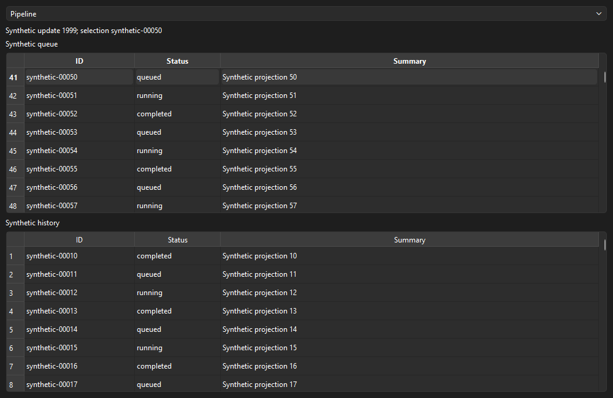

# GUI-PORT-740 — isolated PySide6 compatibility and parity proof

Evidence collected **2026-10-30**; the requested report filename retains its planning date.
Focused assessment under framework v1.2. Qualification outcome: **PASS within the
synthetic scope**. Recommendation: **CONDITIONAL GO for a separately approved,
bounded next Qt package**. Production migration, distribution and application-level
shutdown parity remain unapproved and unqualified.

## Execution profile and source lock

- Class: Narrow, bounded Windows/platform prototype. Model recommendation:
  Claude Code Sonnet 5.5 High; Codex GPT-6.1 Sol High. High addresses QObject
  affinity, disposal and measurement validity without an architectural redesign.
  Current Local/Desktop host; expected about 5M cache-read / 30k output tokens.
- Controller Surface Assessment: **no production controller/coordinator or
  architecture changes**. Existing ports, navigation, AppState and owned-process
  utilities are reused; nothing is extracted or promoted into production.
- Task boundary: `2026-10-30T22:41:16.700Z`, the logged user request before
  discovery, primary session `codex:01a18b77-aa23-7640-98ac-284fef4e5c1f`.
  This is a bounded new-task window in the existing chat, not a claim that the
  earlier HISTORY-610B work belongs to this package's usage.
- Starting checkout: clean `main` at
  `d68b477ba89ae6c5b88fe2e985defed35fcc9196`. Fetch verified `origin/main` at
  that same commit. Remote open-PR query returned none. The separate local
  `codex/history-610b-lineage-compare` work was preserved and is not this base.
- Dedicated worktree: `C:/Users/rob/qual/StableNew-gui-port740`, branch
  `codex/gui-port-740-qt-proof`, created from verified `origin/main`.
- Earlier GUI seams are merged: 700/#214 `46a2f5d7`, 710/#217 `89302eb5`,
  720/#221 `97de7e68`, 730/#230 `7ccb9a8b`. The exercised dispatcher,
  AppState and navigation files have no changes between 730 and this base.
  The newer AI/Learning commits therefore do not require a different proof.
- Exact executed source identity is the six-file SHA-256 map in the accepted
  [metrics](evidence/gui_port_740/metrics.json). Its Git source base is `d68b477b`;
  the local feature commit is reported at completion. These hashes bind the
  uncommitted executed prototype independently of report/commit chronology.

## Environment and isolation

| Item | Observed |
|---|---|
| OS | Windows 11, build 26100, AMD64 |
| Python | CPython 3.14.9, MSC 1944 x64; standard-GIL build, GIL enabled |
| Proof executable | `C:/Users/rob/qual/gui-port740-env/Scripts/python.exe` |
| Isolation | `include-system-site-packages=false`; separate venv, outside all checkouts and managed runtimes |
| Qt / PySide6 / Shiboken | 6.12.0 / 6.12.0 / 6.12.0 |
| Essentials / Addons | Both 6.12.0 |
| Additional metapackage dependencies | PySide6_WebEngine and PySide6_Pdf 6.12.0.140; installed, never imported/executed |
| AppState dependency closure | requests 2.34.2, Pillow 12.3.0, psutil 7.2.2, NumPy 2.5.3, OpenCV 5.0.0.93 and pinned requests dependencies |
| Tk | 9.0.4, in a separate child process |
| CPU | Intel Core i9-13900K, 24 cores / 32 logical processors |
| Display adapter | NVIDIA GeForce RTX 4070 Ti; driver 32.0.16.2101; identity read only |
| Actual desktop | Windows platform plugin, one 2560×1440 screen, 96 DPI, DPR 1.0 (100%) |
| Other scales / monitors | Not exercised; no resolution, DPI or global environment change |

Official PyPI binary wheels were used; `pip check` passed. Exact names, versions,
URLs, dependencies and artifact SHA-256 values are in
[`artifacts.json`](../../tools/qualification/gui_port_740/artifacts.json), with a
hash-pinned Windows/Python 3.14 proof lock. The production `.venv` still reports
PySide6 unavailable. Production requirements, constraints, bootstrap, source,
configuration and managed Forge/Comfy environments are unchanged.

The initial package import/QApplication probe exited 0 with empty stderr. The
accepted matrix contains 16 independently owned GUI children, each contained by
the existing anonymous Windows job/suspended-launch utility, with bounded timeouts.
All exit 0, have empty stderr, no timeout and no observed surviving descendants.
No process is found/adopted by port or name. Python audit hooks reject accidental
network, database and subprocess operations inside either synthetic GUI child;
they are not a native-code security sandbox. The parent samples only its own
launch and creation-time-identified descendants. Native compositor use is ordinary
desktop rendering, not a GPU/model qualification run.

## Runtime and contract results

| Surface / scenario | Evidence and result |
|---|---|
| QtCore, QtGui, QtWidgets | Actual imports, QApplication/QWidget/QMainWindow construction, mapped/exposed first paint and entered event loop: PASS |
| GUI-thread schedule | Queued rather than inline; explicit `run_on_ui_thread` preserves inline semantics: PASS |
| Worker schedule / run / delay | Callbacks execute on the GUI thread; requested 35 ms timer observed at about 35.15 ms in the contract run: PASS |
| Burst and backlog | 2,000 synthetic updates per run, unique completion and GUI-thread assertions, no accepted work lost or duplicated: PASS |
| Callback failure | One intentional ValueError recorded; later delivery continues; unexpected callback faults fail the proof: PASS |
| Repeated disposal / late worker | Idempotent disposal, no post-disposal callback; worker disposal waits for the active callback to finish: PASS |
| Receiver / QObject teardown | Active native timer before receiver deletion, `deleteLater` on receiver/bridge, queued and delayed work canceled without late widget mutation: PASS |
| Shell shutdown | Normal close, repeated close, programmatic quit, deleteLater, pending queue/timer and shutdown-worker submission: PASS |
| Exit semantics | One QApplication loop, no production graceful_exit or os._exit; Python workers joined; disposal at application exit: PASS |
| Synthetic projections | Two 500-row read-only tables; finite status changes, 10 rows removed/added, selected stable ID preserved: PASS |
| Stable navigation | Existing nine workspace IDs/grouping and HOLD label; Pipeline default, invalid ID deterministically rejected: PASS |
| AppStateV2 | Actual instance, injected Qt dispatcher, ordinary and batched notifications from workers, UI-thread delivery, unsubscribe/disable cleanup with Tk forbidden: PASS |
| Mixed toolkit exclusion | No tkinter in Qt; no PySide6 in Tk; optional Qt QML/WebEngine/Multimedia/PDF modules unused: PASS |
| Production shutdown responsibilities | Queue admission/cancellation, runtime stop, persistence and kernel teardown: NOT RUN, outside scope |

The dispatcher is proof-only. Its GUI-owned QObject bridge marshals workers by
queued signals. Capacity is 4096 queued requests / 128 delayed reservations, with
explicit saturation errors. Drains yield after 64 requests or 5 ms. Native timers
belong to the bridge. Disposal is linearized with callback start and cancels
pending work; callbacks must be short and cannot block by joining a worker waiting
on disposal. No production scheduling or shutdown implementation is changed.

## Import-closure findings and migration debt

Every Qt child forbids tkinter imports using a meta-path finder, not merely a
post-hoc grep. Actual imports pass for the dispatcher and presentation-action
ports, task navigation, AppStateV2, Review workflow adapter and content visibility.
The earlier report's direct AppState → GuiInvoker blocker is superseded by the
current injected UiDispatcher contract and actual successful notification test.

One real closure blocker remains:

`src.gui.ui_tokens -> src.gui.design_system_v2 -> tkinter`

The exact ImportError traceback is retained in metrics. The proof therefore uses
native toolkit styling; it does not rewrite AppState, extract style tokens or
introduce a second design system. This blocks direct reuse of the semantic token
module in a Tk-free Qt process, not basic Qt execution.

The full AppController composition is still not an independent Qt host; real Tk
widgets, controller presentation effects, workspace-specific rendering, persisted
UI state and production lifecycle adaptation remain unported. The existing
controller-GUI import ratchet remains 6. This proof neither completes P3-2 nor
extends the Tk-only composition-root owner decision to production Qt.

Concrete future host dependencies include `src/main.py:main` constructing a Tk
root and entering its loop; `src/app_factory.py:build_v2_app` joining the Tk
dispatcher and MainWindowV2; MainWindowV2's real Tk workspaces; and
`src/gui/presentation_actions.py:TkPresentationActions`. A Qt presentation-action
adapter and an approved host lifecycle/composition path would be separate work.
The zero-Tk controller import-closure gate passes; a module's `src/gui` pathname
alone does not prove a Tk dependency.

## Comparable measurements

Five measured samples per toolkit, plus one separately labeled warm-up each.
Both use 500 queue rows + 500 history rows, nine navigation entries, a status
control, single-row selection and a 2,000-update burst. Runs are sequential.
All values below are **minimum / median / maximum** across those five samples.

| Metric | Tk | Qt |
|---|---:|---:|
| Fresh process → verified first render, ms | 611.64 / 622.64 / 638.15 | 1479.08 / 1522.21 / 1530.03 |
| Same-process second-shell render, ms | 23.74 / 25.41 / 28.14 | 17.91 / 18.31 / 19.82 |
| Idle interpreter working set, MiB | 84.41 / 84.65 / 84.80 | 129.51 / 129.96 / 130.38 |
| Native interpreter peak during updates, MiB | 86.15 / 86.45 / 86.65 | 131.09 / 131.59 / 131.65 |
| Sampled owned-tree peak, MiB | 101.35 / 101.45 / 101.67 | 146.77 / 150.00 / 150.09 |
| Initial table construction/population, ms | 5.27 / 5.36 / 5.52 | 14.88 / 15.48 / 15.68 |
| Per-run event p50, ms | 503.48 / 510.50 / 532.31 | 2.95 / 3.10 / 3.42 |
| Per-run event p95, ms | 958.86 / 978.48 / 1024.89 | 3.07 / 3.18 / 3.53 |
| Per-run maximum event latency, ms | 1005.44 / 1026.40 / 1072.53 | 3.07 / 3.20 / 3.55 |
| Per-run maximum post-render heartbeat gap, ms | 16.83 / 19.56 / 36.87 | 9.49 / 10.26 / 15.39 |
| Peak callback backlog | 2000 / 2000 / 2000 | 1980 / 1988 / 1993 |
| Close request → observed process exit, ms | 54.25 / 62.97 / 64.38 | 73.36 / 78.41 / 87.32 |

Memory is native OS working-set measurement, not tracemalloc. The owned-tree
sampler includes the Windows venv redirector, actual interpreter and owned helpers;
it does not confuse a ~5 MiB launcher with Qt's footprint. Process exit includes
the collector's 10 ms polling granularity. Peak_wset is the OS interpreter high
water mark through updates, not a resettable allocation delta.

First render is a proxy: Tk verifies mapped/viewable then flushes idle drawing;
Qt verifies first paint, visibility and exposure. Parent validation refuses false
visibility or missing warm-render proof. Neither measures display photons.
Fresh process means new Python/import state; OS file caches were not flushed and
the platform had already been probed. True OS-cold-cache startup is unqualified.
Warm means second-shell construction within one interpreter, not a production-app
restart. Native row headers, selection details and widget rendering differ.

Qt's callback advantage is substantially a **scheduler-policy comparison**:
the production Tk pump permits 32 callbacks / 8 ms per 15 ms tick; the proof Qt
dispatcher uses queued events and a different yield budget. It is not evidence
that equivalent Tk presentation work must be a second slower, or that production
StableNew would improve by these ratios. Qt's higher startup and roughly 45 MiB
idle-memory cost are measured, stable costs; their detailed library attribution
was not profiled. No framework winner or production UX benefit is established.

Only one 100% display scale was available. Higher/fractional scaling, screen
migration, accessibility tooling and multi-monitor behavior remain unqualified.
The synthetic Qt capture verifies visible controls at the tested scale:

## Independent critical appraisal

| Counterhypothesis | Adjudication |
|---|---|
| H1: AppState is still Tk-bound | Refuted for actual exercised notifications; supported for the separate shared-token closure. Full state/workflow reuse is not proven. |
| H2: teardown breaks callback delivery | Refuted in exercised destruction/disposal/quit cases; production application shutdown remains unqualified. |
| H3: the minimal shell overstates production benefits | Supported limitation. Both are synthetic and omit real workspace features. |
| H4: high-DPI improvement is demonstrated | Unverified: one 96-DPI/DPR-1 screen only. |
| H5: Tk UX improvements cost less | Unverified. No implementation-cost or operator-benefit comparison was performed. |
| H6: widget/test porting dominates expense | Plausible inference from unchanged Tk workspaces; no quantitative migration estimate. |
| H7: licensing prevents adoption | Unresolved distribution prerequisite; local evaluation does not settle it. |

Independent read-only Security Review inspected lifecycle, subprocess ownership,
dependency isolation and evidence validity. Security passed. Its first appraisal
found a blocking measurement defect: Tk emitted the initial/warm timestamp before
mapping (`visible=false`). One batched measurement repair gates actual visibility,
adds parent refusal/regression coverage, separates startup heartbeat time and
remeasures the matrix. Independent reverification returned PASS: 16 passing runs,
all initial/warm visibility true, all Qt exposure true, no survivors, and six
source fingerprints matching. Earlier draft timings are superseded, not averaged
into this result. The earlier immediate-descendant check and launcher-only memory
sampler were prototype measurement defects corrected before accepted evidence.

## Licensing, packaging and decision

PySide6's selected package metadata declares LGPL-3.0-only OR GPL-2.0-only OR
GPL-3.0-only; official Qt documentation also describes commercial licensing.
LGPL use is a plausible future path, subject to its conditions and a per-module
and third-party distribution review. Some Qt modules have different/GPL-only
terms. The installed-but-unused WebEngine/PDF dependencies enlarge a future
redistribution audit; their presence is not approval to ship them.
StableNew's canonical LICENSE/copyright/distribution decision remains unresolved.
No licence, commercial terms, installer, frozen binary or distribution model is
selected here. These are future owner decisions, not a blocker to authorized
local evaluation. Primary sources:
[PyPI 6.12.0](https://pypi.org/project/PySide6/6.12.0/),
[Qt LGPL obligations](https://www.qt.io/development/open-source-lgpl-obligations),
[QObject thread rules](https://doc.qt.io/qt-6/threads-qobject.html),
[Qt high DPI](https://doc.qt.io/qt-6/highdpi.html).

**CONDITIONAL GO** is justified for further bounded technical work because actual
imports, rendering, thread delivery, state/navigation reuse and contained teardown
passed. Before a real Qt host package: resolve the token import closure; set an
acceptable startup/memory budget and a named operator benefit; qualify required
display scales; and settle the proposed modules/distribution path. Real workspace,
queue/persistence and production shutdown parity need their own accepted tests.

Smallest next proposed package: **GUI-SEAM-741 — toolkit-neutral style values**.
Separate immutable design values from Tk registration/helpers with Tk-forbidden
import tests while preserving existing Tk appearance. This is a proposal only.
Do not start a production Qt shell, port workspaces or change the Tk composition
decision on the strength of this proof.

## Reproduction, validation and retention

Setup, opt-in command, exact lock, bounded inputs and safe teardown are in the
[harness README](../../tools/qualification/gui_port_740/README.md). The isolated
environment and external draft evidence remain under `C:/Users/rob/qual/` for
review; only accepted evidence is checked in. Remove the harness when a separately
approved Qt package replaces its contracts, or the owner closes the Qt option;
preserve this verdict and accepted evidence.

Token-Efficient Validation Plan: static contract/environment checks first, then
one bounded synthetic proof and the five-sample comparison; reject invalid
measurement data, batch/reverify confirmed defects; run hermetic harness tests
without PySide6, final aggregate review and one canonical Python 3.14 PR gate.
Reuse unchanged GUI seam/production evidence; no full application, GPU or backend
execution. Focused CI tests: **9 passed**. Canonical gate: **PASS on one invocation**;
14,870 collected, 358 required smoke tests passed with two warnings, repository
unchanged. Completeness, Ruff, mypy smoke/ratchet, formatting/exception/architecture
ratchets, controller ceilings and Tk boundary all passed. Accepted validation tree
is `c36ded79f016fec67633937a4e63fe036fdc302d`; subsequent changes are report-only.
The log remains `C:/Users/rob/qual/gui-port740-gate.log`.

Aggregate review found no production-source/dependency/default/persistence change.
Independent security/evidence review PASS followed the one measurement repair and
its reverification. Final commit and the measured task-window usage are reported
at completion; missing reviewer telemetry must be disclosed, not estimated.
No publication or merge is authorized or performed.

### Model / usage calibration

Local/Desktop, actual primary and read-only reviewer GPT-6.1 Sol High; one batched
measurement repair/reverification, result PASS. The independent review session is
`codex:01a18f08-6c4c-7491-b58c-db927e75c06a`; approval review is
`codex:01a18b78-5cf0-70f3-83c3-5905dc90fb74` (`codex-auto-review`, effort unavailable).
The prescribed reporter exposes all three sessions in this task window.

Closeout checkpoint `2026-10-30T22:41:16.700Z`–`2026-10-30T23:08:55.350580Z`:
789,012 fresh input, 15,256,704 cache-read, zero cache-write and 73,566 output
tokens, including 35,211 reasoning tokens within output. This precedes the final
commit/reply; the completion report gives the later measured checkpoint.

Cache-read already slightly exceeds 3× the 5M planning estimate; output is about
2.45× the 30k estimate. The larger retained chat context, prototype measurement
repairs/recollection and independent appraisal explain the extra work/context
consumption. A future bounded proof should start from a fresh source-lock handoff
rather than carrying the earlier large implementation chat. One package does not
justify changing the model-selection matrix or escalating the model tier. No
missing usage is estimated and tokens are not converted to price.
