# StableNew Focused Assessment — ARCH-DESIGN-950 Coordination-Hotspot Decomposition — 2026-11-10

Assessment class: Focused. Execution class: Architectural (research and design only).
This report is a decision aid. It does not supersede `AGENTS.md` or `STATUS.md`, changes no production code, and
authorizes none of the packages it proposes.

## Source lock and scope

- Repository `destroyer42/StableNew2`; base `origin/main` `fdd900a93dd966a5f26c6453aac495447c69bd81` (PR #278 merge,
  2026-11-10). Branch `research/arch-design-950-coordination-hotspots`, created from that SHA in a dedicated worktree.
- Evidence is static: source, tests, imports and Git history at the locked SHA. No application, test census, GPU, Forge,
  A1111, Comfy or SVD runtime was executed. Every count below is reproducible with the scripts in
  [the structural inventory](evidence/arch_design_950/STRUCTURAL_INVENTORY.md).
- Authorities read: `AGENTS.md`, `STATUS.md`, `docs/CODEX_MAP.md`, `docs/ARCHITECTURE_v2.6.md` sections 6 and 11-14,
  `docs/AI_MODEL_SELECTION.md`, `docs/AGENT_OPERATING_MODEL.md`. The 2026-10-16 audit
  (`docs/audits/2026-10-16_repo_audit_and_roadmap.md` section 4.C and Phase 4) is used as historical comparison only.
- Targets: `src/controller/app_controller.py`, `src/pipeline/executor.py`, `src/pipeline/pipeline_runner.py`,
  `src/gui/controllers/learning_controller.py`, `src/gui/views/experiment_design_panel.py`,
  `src/gui/views/model_evidence_window.py`, and their service packages.

## 1. Executive findings and baseline

1. **About 2,000 lines of the hotspots are unreferenced code, not coordination.** 59 methods (1,559 lines) in the five
   coordination files are named nowhere else in any tracked Python file and are unreachable from any referenced method;
   one 458-line module (`src/pipeline/payload_builder.py`) is reachable only through them and its own test. The largest
   item is `Pipeline.run_pack_pipeline` (454 lines), a complete legacy multi-stage orchestration path beside the canonical
   runner. `docs/Subsystems/Image/IMAGE_PIPELINE.md` lines 375-376 already records the executor and runner items as
   dead; they were never deleted. Removing them is the highest-return, lowest-risk first package (ARCH-951).
2. **The line ratchet shrank `AppController` without reducing its responsibilities.** Since the 2026-10-16 audit it
   went from 7,414 to 6,816 lines, but methods only from 346 to 339, attributes set in `__init__` went from 89 to 90
   and `__init__` itself from 322 to 327 lines. The extraction homes hold 1,259 lines in 11 services, yet the two cleanest read-only
   clusters (diagnostics, 794 lines; history media projection, 307 lines) are still inside the controller.
3. **Partial extraction has already produced duplicate state once.** `DiagnosticsCoordinator` and `AppController` each
   keep their own copies of the three original exception hooks (`app_controller.py:545-547` and
   `diagnostics_coordinator.py:13-15`). This is the failure mode every proposed package must avoid.
4. **One data-safety violation is confirmed.** `LearningController.undo_review_feedback`
   (`learning_controller.py:2705-2754`) rewrites the whole learning-record JSONL with `Path.write_text`, outside
   `LearningRecordWriter`, without its lock and without `src/utils/atomic_io.py`. This is a gate item (ARCH-954), not a
   ranked refactor.
5. **The executor's remaining size is mostly essential.** After the dead paths go, about 5,660 lines remain: four live
   stage methods (2,601 lines with `run_svd_native_stage`) and lifecycle-critical recovery and progress code. Deeper
   decomposition depends on two open owner decisions (move into `image_backends`; typed stage settings) and should not
   be forced now. One typed-protocol step is safe today (ARCH-956).
6. **`LearningController` hosts an independent feature.** Staged curation plus the discovered-review inbox is 44 methods
   and 942 lines (23% of the file); nothing else in the controller calls into staged curation.
7. **Tk view decomposition should wait.** The toolkit decision is open (`DR-O12b`), Model Evidence is under active product
   work (MEC-900), and about four fifths of each target view is widget code. No view package is proposed.

Baseline at `fdd900a9` (physical lines; commits exclude merges):

| File | Lines | Commits 90 d / 30 d | Fix-like commits 90 d | Methods (public) | Importing `src` modules | Imported `src` modules | Test files naming it |
|---|---|---|---|---|---|---|---|
| `src/controller/app_controller.py` | 6,816 | 50 / 25 | 22 | 339 (154) | 3 | 75 | 103 |
| `src/pipeline/executor.py` | 6,590 | 43 / 16 | 15 | 92 (14) | 1 | 40 | 68 |
| `src/gui/controllers/learning_controller.py` | 4,123 | 38 / 20 | 15 | 155 (89) | 3 | 67 | 50 |
| `src/pipeline/pipeline_runner.py` | 2,210 | 30 / 11 | 5 | 47 (3) | 8 | 37 | 59 |
| `src/gui/views/experiment_design_panel.py` | 2,577 | 20 / 11 | 3 | 106 (11) | 1 | 36 | 11 |
| `src/gui/views/model_evidence_window.py` | 2,010 | 13 / 13 | 3 | 57 (2) | 2 | 31 | 6 |
| `src/controller/pipeline_controller.py` | 1,697 | 20 / 8 | n/m | 107 (59) | 1 | 35 | 44 |

Only the four files in `tools/ci/controller_surface_baseline.json` are size-ratcheted (`app_controller.py` 6,816,
`pipeline_controller.py` 1,697, `job_service.py` 1,227, `job_history_service.py` 647). The executor, runner and
`learning_controller.py` are unbounded.

Drift recorded, not repaired here: `STATUS.md` Known debt still says `AppController` is 7,307 lines (it is 6,816).

## 2. Current hotspot ranking

Ranked by architectural priority, not size. Evidence columns are from section 1 and the inventory.

| Rank | Hotspot | Why it ranks here | Disposition |
|---|---|---|---|
| 1 | Unreferenced legacy paths across executor, runner, both controllers and the Learning controller | Zero behavior, pure cost: read on every agent pass, repaired by mistake, and a dormant second orchestration path | ARCH-951, first |
| 2 | `AppController` | Highest churn and fan-out (75), 22 fix-like commits, 97 attributes, constructed by tests through `__new__` in 35 files | ARCH-952, ARCH-953 |
| 3 | `LearningController` | Second-highest churn, lives in `src/gui/`, owns domain work and one unsafe store write | ARCH-954 (gate), ARCH-955 |
| 4 | `executor.py` | Large and repaired often, but one importer and essential coupling; decomposition blocked on owner decisions | ARCH-951 share, ARCH-956; rest deferred |
| 5 | `pipeline_runner.py` | `run_njr` is already orchestration only (136 lines, P4-1); the remainder is dead code plus video and training branches | ARCH-951 share; no further package |
| 6 | `experiment_design_panel.py`, `model_evidence_window.py` | Presentation; toolkit decision open; one is under active product work | Defer |
| - | `review_tab_frame_v2.py`, `video_workflow_tab_frame_v2.py`, `prompt_tab_frame_v2.py` | Higher 30-day churn (20, 21, 17) than either named view | Defer with the views; listed so the named views are not mistaken for the worst |

## 3. Responsibility and dependency maps

Production execution chain (verified by import and call sites; `src/app_factory.py:63` constructs `AppController`,
which constructs `PipelineController`, which constructs `JobExecutionController` and `JobService`):

```mermaid
flowchart LR
  V[src/gui views] --> AC[AppController]
  AC --> PC[PipelineController]
  PC --> JS[JobService.submit_njrs]
  JS --> Q[JobQueue / JobRepository SQLite]
  Q --> SR[SingleNodeJobRunner]
  SR --> RJ[PipelineController._run_job]
  RJ --> RN[PipelineRunner.run_njr]
  RN --> H[run_stage_handlers]
  H --> IB[PipelineRunner._execute_image_backend]
  IB --> WB[WebUIFamilyImageBackend.execute]
  WB --> EX[Pipeline.run_*_stage]
  EX --> CL[SDWebUIClient]
```

`AppController` (339 methods) by responsibility, in source order:

| Cluster | Lines | Methods | Shared state it touches | Assessment |
|---|---|---|---|---|
| UI dispatch, debounce, runtime-status throttle (748-1160) | 393 | 19 | 12 exclusive attributes; `main_window`, `app_state` | GUI-thread rule lives here; essential, leave |
| Run and queue submission entry points (1316-1796, 6064-6170) | 550 | 40 | `pipeline_controller`, `app_state`, `job_service` | Many aliases funnel to `start_run_v2`; trimmed by ARCH-951 |
| Reprocess, Review and Photo Optimize submission (1797-2374) | 559 | 18 | `job_service`, `_api_client`, `app_state` | Compile-adjacent; defer |
| Queue stack wiring and callbacks (2461-2855) | 360 | 25 | `job_service`, `_runtime_projection_coordinator` | See risk R5; owner decision |
| Queue commands (2856-3040) | 169 | 19 | `job_service` | Thin delegates; correct as is |
| Diagnostics and job explanation (3268-4100) | 794 | 37 | 10 exclusive attributes, 18 shared | Read-only; ARCH-953 |
| Shutdown (4427-4675) | 239 | 9 | `_is_shutting_down`, `webui_process_manager` | Owned-process lifecycle; leave |
| Packs, config, stage-override collection (4701-6063) | 1,270 | 68 | `_config_manager`, `app_state`, `main_window` | Intent semantics; defer until typed stage settings |
| Video, SVD and training hand-offs (6177-6497) | 298 | 26 | `job_service`, `main_window` | Thin; leave |
| History media projection (6498-6816) | 307 | 10 | reads `app_state` only | Pure; ARCH-952 |

`Pipeline` (executor, 92 methods): prompt optimisation 170 lines; manifest and metadata 297; model and VAE sync 118;
runtime pressure and admission 734; WebUI recovery and health 315; generation, recovery and progress polling 737
(`_poll_progress_loop` alone is 385); live stage methods 2,601; unreferenced 904.

`LearningController` (155 methods): experiment design and plan 614 lines; variant NJR and baseline 803; ratings and
review feedback 698; workflow and resume state 307; recommendation apply 181; staged curation 666; discovered inbox
and scan 276; unreferenced 105.

## 4. Verified architecture risks

Confirmed violations and hazards (each verified at the cited lines):

| ID | Finding | Evidence | Class |
|---|---|---|---|
| R1 | A complete legacy orchestration path remains beside the canonical runner | `Pipeline.run_pack_pipeline` (`executor.py:4320`, 454 lines), `run_img2img`/`_run_img2img_impl` (3323, 3343), `run_upscale`/`_run_upscale_impl` (2994, 3015): no reference in any tracked `.py` file outside `executor.py`; `80f097f9` (2025-12-01) is the last commit that changed occurrences of `run_pack_pipeline(` in `src` or `tests` | Obsolete code; dormant second path |
| R2 | A second payload builder is tested but never executed | `PipelineRunner._build_stage_payload` (`pipeline_runner.py:1915`) is the only production importer of `build_sdxl_payload`; it has no caller. `tests/api/test_sdxl_payloads.py` asserts on that builder | False test assurance |
| R3 | An unlocked, non-atomic second writer on the learning-record store | `learning_controller.py:2705-2754` reads, filters and rewrites `records_path` with `write_text`; `LearningRecordWriter` (`src/learning/learning_record.py:224`) is documented append-only and appends under `evidence_file_lock`, which the undo path never takes | Data safety; violates the `atomic_io` rule in `docs/CODEX_MAP.md` |
| R4 | Duplicate exception-hook state after a partial extraction | `app_controller.py:545-547`, `2553`, `3434-3454` and `diagnostics_coordinator.py:13-15, 30, 34` | Duplicate mutable state |
| R5 | A dormant second wiring of the queue stack | `AppController._build_job_service` (`app_controller.py:2474`) builds `JobRepository`, `JobQueue` and `JobService` with `_execute_job` (2592) as run callable. In the default composition it is not reached: `PipelineController` always creates its own service (`pipeline_controller.py:689-693`) and `AppController.__init__` adopts it (574-583). Statically verified; not runtime-traced | Composition; open owner decision 11 / P3-2 |
| R6 | `AppController` reaches into `PipelineController` private members | 11 sites (`_job_controller` 3, `_webui_connection` 2, `_job_service` 2, and three `_app_state_*_managed_externally` flags set at 568-570 to stop two publishers of the same projection) | Coupling; display projection only, not execution truth |
| R7 | Service extractions that pass the owner back in | Five of seven `src/learning/learning_controller_services/` modules and three `job_service_*` modules take the controller or service instance and read its private members | Moves code without creating a boundary |
| R8 | Test construction bypasses the constructor | 62 `AppController.__new__` sites in 35 test files; 76 of 184 private `AppController` methods and 28 of 77 private `Pipeline` methods are named in tests | Makes state relocation expensive |

Size or style concerns that are **not** violations: the length of the live stage methods; the count of thin queue
command delegates; the 327-line `__init__` (it is the Tk-host composition root accepted under decision 11); the views'
widget-building methods.

Root causes, per hotspot:

- **`AppController`**: it is both composition root and the callback surface for every tab, so each feature added one
  more public method. The ratchet rewards moving lines, not removing responsibilities. Essential coupling: UI-thread
  marshalling, shutdown ordering and owned-process lifecycle. Underused abstractions: `DiagnosticsCoordinator`,
  `RuntimeProjectionCoordinator`, `PresentationActions`.
- **Executor**: it is the WebUI-family backend living in generic `src/pipeline`; stage configuration is untyped
  (`.get(` 567 times); each stage repeats the same sequence. Essential coupling: per-run mutable state shared by
  admission, recovery and progress polling (`client`, `_current_stage_chain`, `_true_ready_gated`).
- **`LearningController`**: every study type and the curation feature were added to the one object the Learning tab
  already held. Essential coupling: workflow and resume state with plan and ratings. Underused: `src/curation/`,
  `LearningRecordWriter`.
- **Views**: one class per window with 53-101 instance attributes; toolkit-neutral logic (`assess_row`,
  `_validate_experiment_data`) sits inside Tk modules although `src/gui_v2/` exists for it.

Where more abstraction would be counterproductive: a generic stage "template method" across the four stage methods
(the differences are the content); a facade over `JobService` in `AppController` (the delegates are already thin);
splitting `__init__` before the composition decision; a base class for views before the toolkit decision.

## 5. Tested assumptions and competing approaches

Assumptions checked and what was found:

| Assumption | Test | Result |
|---|---|---|
| The largest file is the first priority | Churn, fan-in and cluster cohesion | False. The first priority is code with no caller in any of the five files |
| Unreferenced methods might be reached dynamically | Listed every `getattr(controller, <variable>)` site (`presentation_actions.py:39`, `job_history_panel_v2.py:683`, `queue_panel_v2.py:1049`, `base_generation_panel_v2.py:648`); searched for composed names | All use string literals present in `src`; no composed method names exist. Literal strings count as references in the analysis |
| Unreferenced methods might be named in config, JSON or tools | `git grep -w` over every tracked file | Names occur only in the defining file, plus dated docs |
| NJR construction still happens in the GUI controller (audit C2) | `git grep "NormalizedJobRecord("` | Resolved: eight sites, none under `src/gui/` |
| `run_njr` is still a monolith (audit C3) | AST | Resolved: 136 lines; handlers in `run_stage_handlers.py` |
| The executor has many model-family branches | Line scan | 17 lines, 11 of them in `run_txt2img_stage` |

Approaches compared for each significant candidate:

| Candidate | Extract-and-delegate | Cohesive service or view model | Typed protocol | Remove obsolete code | Defer |
|---|---|---|---|---|---|
| Unreferenced paths | n/a | n/a | n/a | **Chosen**: no behavior, no test change for tier A | Keeps the cost |
| History media projection | Would leave private delegates behind | **Chosen**: pure functions over history entries | Not needed | n/a | Low cost to do |
| Diagnostics | Repeats R4 | **Chosen**: read model with explicit sources; coordinator owns hooks | A small sources protocol is part of it | n/a | Acceptable |
| Staged curation and inbox | Repeats R7 if the controller is passed in | **Chosen**: coordinator with explicit dependencies | Callbacks for refresh notifications | n/a | Acceptable while Learning churn is high |
| Executor stage methods | High regression risk | Blocked on decisions 14 and typed settings | **Chosen now**: `StageExecutor` protocol at the backend seam | Done by ARCH-951 | **Chosen** for the rest |
| Views | Obsolete if the toolkit changes | Toolkit-neutral logic to `src/gui_v2/` is safe but small | n/a | n/a | **Chosen** |

Independent challenge of the preferred design (second pass, different method: adversarial reading of each package
for ways it adds complexity or changes semantics):

- *ARCH-951 could delete something live.* Mitigations: two independent methods agree (closure analysis and whole-repo
  name search), the living image doc reached the same list earlier, and the full census is the required gate. Residual
  risk: a name used only from an untracked operator script. `_get_batch_runs` is deliberately excluded because open
  owner decision 4 in `STATUS.md` concerns it.
- *ARCH-952 and ARCH-953 could become "move lines to satisfy the ratchet".* Guard: a package counts only if the new
  module takes no controller instance and the controller keeps no copy of moved state.
- *ARCH-953 could change which hook is restored at shutdown.* The two copies capture the threading hook at different
  moments (controller at construction, coordinator at install). The contract requires a test that pins today's
  restore behavior before any change.
- *ARCH-955 could create a second curation authority.* `src/curation/` already owns the workflow model; the coordinator
  must reuse `CurationWorkflowBuilder` and `DiscoveredReviewStore` instances rather than construct new stores.
- *The ranking could be an artifact of static analysis.* It is. No runtime profile or agent-token measurement backs
  the efficiency claims; section 9 labels them as hypotheses.

## 6. Target decomposition boundaries

- `AppController` remains the Tk-host composition root and callback surface. Read-only projections move behind
  toolkit-neutral modules that receive data, not the controller. It keeps UI dispatch, shutdown and lifecycle.
- `PipelineController`, `JobService`, `JobQueue`, `JobRepository` and `PipelineRunner.run_njr` are unchanged by every
  package. No package adds a submission path, a run callable, a store or a status.
- `LearningController` remains the Learning tab's coordinator for design, plan, run, rating and resume. Curation and
  the inbox become a separate coordinator under `src/learning/` or `src/curation/`. The record store has one writer.
- `Pipeline` stays in `src/pipeline/executor.py` until owner decision 14. The seam to it becomes a typed protocol so
  the later move is a relocation, not a redesign.
- Rule for every extraction: explicit dependencies in, no owner instance passed, no state kept in two places, tests
  move with the code they assert on.

## 7. Ordered implementation plan

Six packages. Each is independent of unresolved owner decisions except where stated. Token figures are order of
magnitude.

| Order | Package | Single outcome | Class | Claude Code / Codex | Host | Expected usage |
|---|---|---|---|---|---|---|
| 1 | **ARCH-951** Remove unreferenced legacy execution and submission paths | The five coordination files and `src/pipeline/` hold no symbol without a reference | Standard | Sonnet 5.5 High / GPT-6.1 Sol High | Local | ~10M cache-read, 50k output |
| gate | **ARCH-954** One writer for the learning-record store | Undo goes through `LearningRecordWriter` under its lock with an atomic replace | Narrow | Sonnet 5.5 High / GPT-6.1 Sol Medium | Local or cloud | ~4M cache-read, 20k output |
| 2 | **ARCH-952** History media projection out of `AppController` | History-entry to image/video summaries are pure functions outside the controller | Standard | Sonnet 5.5 High / GPT-6.1 Sol High | Local or cloud | ~8M cache-read, 40k output |
| 3 | **ARCH-953** Diagnostics read model with one hook owner | Diagnostics snapshots and job explanations are built outside the controller; hook originals have one owner | Standard | Sonnet 5.5 XHigh / GPT-6.1 Sol High | Local | ~15M cache-read, 60k output |
| 4 | **ARCH-955** Curation and discovered-inbox coordinator | Staged curation and the inbox are coordinated outside `LearningController` with explicit dependencies | Standard | Sonnet 5.5 High / GPT-6.1 Sol High | Local | ~15M cache-read, 60k output |
| 5 | **ARCH-956** Typed stage-executor seam and hotspot ratchets | The backend calls the executor through a protocol; the three unbounded hotspots get ceilings | Standard | Sonnet 5.5 High / GPT-6.1 Sol High | Local or cloud | ~6M cache-read, 30k output |

ARCH-954 is a safety gate, not a ranked item: it has no dependency on ARCH-951 and may be authorized first or in
parallel. It edits `learning_controller.py` lines that ARCH-951 does not touch; run them sequentially to avoid a
trivial merge.

Contracts for packages 2-5 and the gate (ARCH-951 is in section 8):

### ARCH-954 — One writer for the learning-record store

- Problem: risk R3. Outcome: `LearningRecordWriter` gains the remove-latest-matching operation, performed under
  `evidence_file_lock` and written with `atomic_write_text`; the controller method delegates.
- Surfaces: `src/learning/learning_record.py`, `src/gui/controllers/learning_controller.py` (2705-2754),
  `tests/controller/test_learning_controller_review_feedback_undo.py`, a new writer-level test.
- Unchanged authority: file location, JSONL format, record schema, matching rule (latest record with
  `metadata.source == "review_tab"` and the optional run and image filters), return values, recommendation refresh.
- Exclusions: record schema, rating semantics, recommendation engine, any other store.
- Tests: existing undo tests unchanged and green; new tests for no-match, empty file, concurrent append during undo,
  and a failed replace leaving the original file intact.
- Validation: focused tests, `python tools/ci/run_pr_gate.py`, hosted `required`, `full-suite`, `windows`.
- Metric: `write_text` calls on stores in `src/gui/controllers/`: 1 to 0. Risk: lock ordering; rollback is a revert.
- Security trigger: filesystem write path, so the Security Review trigger in `docs/AGENT_OPERATING_MODEL.md` applies.
- Stop if the fix needs a schema or format change, or if another unlocked writer of the same file is found.

### ARCH-952 — History media projection out of `AppController`

- Problem: ten methods (`app_controller.py:6498-6816`, 307 lines) turn history entries into image and video summaries.
  They read only `app_state.history_items`, call nothing else on the controller, and are reached from seven call
  sites in the hand-off methods and one view (`src/gui/views/svd_tab_frame_v2.py:1579`).
- Outcome: one toolkit-neutral module of pure functions; the controller keeps `get_recent_svd_history` and the
  `send_history_job_*` hand-offs as callers of it.
- Home: beside the existing projections `src/video/recent_video_outputs.py` and `src/video/sequence_history.py`. The
  implementer must first check whether `recent_output_from_entry` already covers part of `_build_svd_history_record`
  and reuse it; a second projection of the same artifact shape is a stop condition.
- Unchanged authority: `JobRepository` and history projection, `app_state.history_items`, record dictionaries returned
  to the SVD tab (key for key), sort order, limits.
- Exclusions: the hand-off methods (6177-6497), any GUI file, history persistence.
- Tests: the seven test files that name these methods move their assertions to the new functions; add a characterization
  test over recorded history entries before moving code.
- Metric: `app_controller.py` minus about 300 lines; ceiling lowered. Rollback: revert.
- Stop if any function needs controller state other than history entries.

### ARCH-953 — Diagnostics read model with one hook owner

- Problem: 37 methods (794 lines, `app_controller.py:3268-4100`) build diagnostics snapshots, job explanations and
  thread/process snapshots; risk R4.
- Outcome: a diagnostics read-model service under `src/controller/app_controller_services/` that receives an explicit
  sources object (job service, pipeline controller, process manager, connection controller, app state, log handler)
  and returns the same snapshot dictionaries; `DiagnosticsCoordinator` becomes the only holder of the original hooks.
- Unchanged authority: snapshot keys consumed by the GUI panels that call `get_diagnostics_snapshot`,
  `explain_job` and `get_job_explanation_payload`; bundle generation; watchdog events; the exception handlers' behavior.
- Exclusions: `ProcessAutoScannerService`, watchdog policy, shutdown ordering, `PresentationActions`.
- Tests: pin the hook install/restore sequence first; the 13 diagnostics test files keep their assertions.
- Metric: `app_controller.py` minus about 750 lines; attributes minus 10. Risk: thread snapshot timing and hook
  restore order. Rollback: revert.
- Stop if the read model needs to mutate controller state other than the heavy-snapshot cache it owns.

### ARCH-955 — Curation and discovered-inbox coordinator

- Problem: 44 methods (942 lines, `learning_controller.py:3118-4123` less the scan trigger's GUI part) form a feature
  that the rest of the controller never calls; each public method has one caller in `src/gui/views/`.
- Outcome: a coordinator with explicit dependencies (`DiscoveredReviewStore`, `CurationWorkflowBuilder`,
  `ReviewWorkflowAdapter`, `LearningRecordWriter`, a job-service getter, a baseline-config getter, a refresh callback).
  Views obtain it from the controller; the controller holds no curation methods.
- Unchanged authority: the stores, `src/curation/` models, queue admission through `JobService.submit_njrs`, lineage.
- Exclusions: recommendation engine, ratings, experiment design, the views' layout.
- Tests: the eleven test modules that name staged curation; add a submission test proving advancement still admits
  through `JobService.submit_njrs`.
- Metric: `learning_controller.py` minus about 900 lines. Risk: the coordinator constructs its own store (second
  authority). Rollback: revert.
- Schedule only when no Learning feature PR is in flight (20 commits in 30 days). Stop if the UX-850 Learning
  redesign is authorized first; re-plan against it.

### ARCH-956 — Typed stage-executor seam and hotspot ratchets

- Problem: `WebUIFamilyImageBackend.execute(self, pipeline: Any, ...)` (`webui_family_backend.py:238`) calls four
  `Pipeline.run_*_stage` methods through an untyped parameter; three hotspots have no size ceiling.
- Outcome: a `StageExecutor` protocol in `src/image_backends/` naming exactly the methods the backend and runner use;
  `executor.py`, `pipeline_runner.py` and `learning_controller.py` added to the size ratchet at their then-current size.
- Unchanged authority: executor location and behavior; `PipelineRunner.run_njr`; backend registry.
- Exclusions: moving the executor (decision 14), typed stage settings (P4-4), any stage logic.
- Needs owner decision OD-2 for the ratchet half; the protocol half needs none.
- Metric: `Any`-typed executor parameters at the seam: 1 to 0; ratcheted hotspots 4 to 7. Rollback: revert.

Explicitly not proposed: an executor stage refactor, a generation/progress collaborator (lifecycle-critical, 19 test
files touch it), config and stage-override extraction from `AppController`, a composition-root change, any view split.

## 8. First recommended package: ARCH-951

Why this one: the boundary is exact (a symbol either has a reference or it does not); the existing census covers every
live path; it removes about 2,000 lines with no behavior change; it does not touch queue, persistence or process
ownership; it cannot be made obsolete by GUI or product work; and it lowers the risk of every later package (three of
the executor's duplicated stage implementations disappear).

Acceptance contract (summary; the copy-paste prompt is
[`docs/work_packages/ARCH-951_unreferenced_legacy_path_removal.md`](../work_packages/ARCH-951_unreferenced_legacy_path_removal.md)):

- Delete tier A: the 58 listed methods (all of the inventory's 59 except `_get_batch_runs`).
- Delete tier B only as a unit: `src/pipeline/payload_builder.py` with `tests/api/test_sdxl_payloads.py`, after
  confirming that test file asserts on nothing else.
- Do not touch tier C (40 methods referenced only by tests, 843 lines).
- No change to any referenced symbol's body, signature or behavior. No other test file changes, except removing an
  import that only served deleted code.
- Lower the `app_controller.py` and `pipeline_controller.py` ceilings; lock ratchet improvements with `--update`.
- Correct the two stale statements: the `executor.py:4815` comment and `IMAGE_PIPELINE.md` lines 375-376.
- Evidence: `python tools/ci/run_pr_gate.py --full` locally and green hosted `required`, `full-suite` and `windows`.
- Expected result: `executor.py` about 5,660 lines, `pipeline_runner.py` about 1,970, `app_controller.py` about
  6,550, `learning_controller.py` about 4,010, `pipeline_controller.py` about 1,600.

## 9. Expected benefits (hypotheses until measured)

| Hypothesis | Basis | How to measure |
|---|---|---|
| H1: ARCH-951 removes about 2,000 `src` lines (13.7% of the executor) | Method spans summed from the AST | `wc -l` before and after |
| H2: a full read of the executor costs about 10k fewer tokens | 904 of 6,590 lines; the file is 300,607 bytes; about 4 bytes per token is an approximation | Token count of the file before and after |
| H3: agents stop repairing dead copies | `IMAGE_PIPELINE.md:375` warns against it today | No commit touching deleted regions exists by construction |
| H4: packages 2-4 cut `AppController` by about 1,050 lines and `LearningController` by about 900 | Cluster spans | Ratchet baseline values |
| H5: projection and diagnostics tests no longer need `AppController.__new__` | Pure functions take data | Count of `__new__(AppController)` sites (62 today) |
| H6: measured usage of hotspot PRs falls | Smaller files re-read each turn | Compare `Model / usage` lines of the next five PRs touching these files with earlier ones; not attributable to one cause |

No hypothesis is a commitment. H2 and H6 depend on how agents read files, which this assessment did not observe.

## 10. Risks, owner decisions and stop conditions

Owner decisions:

| ID | Decision | Needed for |
|---|---|---|
| OD-1 | Authorize ARCH-951, and state whether tier B (`payload_builder.py` plus its test file) is included | ARCH-951 |
| OD-2 | Extend the size ratchet to `executor.py`, `pipeline_runner.py`, `learning_controller.py` (audit decision 15) | ARCH-956 |
| OD-3 | Tier C policy: delete test-only code together with its tests, or keep it | A later cleanup, not ARCH-951 |
| OD-4 | Risk R5 under the open runtime-stack composition decision (P3-2): retire or keep `AppController`'s fallback queue-stack wiring | No package here |
| OD-5 | `_get_batch_runs` is unreferenced; it is the code behind `STATUS.md` open decision 4 | Decision 4 |
| OD-6 | Decision 14 (executor into `image_backends`) and typed stage settings remain prerequisites for deeper executor work | Deferred work |
| OD-7 | Whether ARCH-954 runs before ARCH-951 | Sequencing |

Program stop conditions: any package that needs a new queue, runner, compiler, repository, history, cancellation or
runtime authority; any change to persisted formats, compatibility policy or process ownership; a service that must
receive its owning controller; a ratchet ceiling that would rise; more than two materially different failure classes
in one package; an authorized product package that claims the same lines.

## Review quality

- Coverage: static only. Not covered: runtime behavior, real test execution, operator scripts outside the repository,
  the other large GUI views beyond their churn numbers.
- Method diversity: AST closure analysis, whole-repository name search, Git pickaxe history, cross-check against the
  living image doc, and an adversarial second pass (section 5).
- Known limits: word-level name matching is conservative, so more unreferenced code probably exists than is listed
  (for example `_build_stage_payload` was only caught by the doc cross-check, because a stale comment names it).

## Evidence links

- [Structural inventory, symbol lists and scripts](evidence/arch_design_950/STRUCTURAL_INVENTORY.md)
- [ARCH-951 work package (proposed)](../work_packages/ARCH-951_unreferenced_legacy_path_removal.md)
