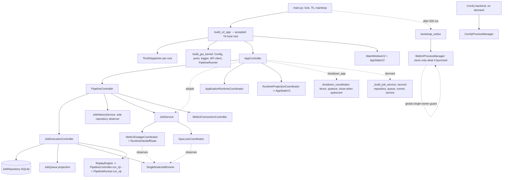

# StableNew2 P3-2 — Runtime composition root: architecture decision and implementation contract

Assessment class: Focused. Execution class: Architectural (read-only research and planning).
This report is a decision aid. It changes no code, authorizes no package and does not supersede `AGENTS.md` or `STATUS.md`.

## 0. Source lock

| Item | Value |
|---|---|
| Task start | 2026-11-12T06:09:19-05:00 (11:09:19Z), recorded with the first command, before discovery |
| Session | Claude Code desktop, `claude:1522b543-5f05-4174-8f86-6b4fe3af56c3`, one top-level session, no subagents |
| Checkout | `C:/Users/rob/projects/StableNew-main`, branch `main` |
| HEAD | `67e0e559d1998321d567e78f9b4e16cf4e6d9807` (merge of PR #288) |
| Remote `main` | `67e0e559d1998321d567e78f9b4e16cf4e6d9807` (`git ls-remote origin refs/heads/main`), identical to HEAD |
| Diff | one unrelated user change, `presets/settings.json` (3 insertions, 3 deletions); untouched, identical at closeout |
| Files written by this package | none during the research. Afterwards, at the owner's request, this report and `docs/work_packages/P3-2A_runtime_stack_consolidation.md` were committed on `research/p3-2-runtime-composition-root`; the trace plugin was not committed |
| Owner decision | 2026-11-12: stage A authorized with amendments, recorded in the work package, which supersedes section 10 below where they differ |

Evidence labels: **[S]** read in source at the locked SHA; **[T]** observed at runtime in the instrumented hermetic test
pass described in section 2.3; **[D]** taken from a repository document and re-checked where stated.
Not done, by instruction: no application launch, no GPU, Forge, SVD or Comfy start, restart or qualification.

## 1. Recommendation

Adopt a **staged P3-2**, and authorize only stage A now:

- **P3-2A (recommended, behavior-preserving):** one factory module, `src/app/runtime_stack.py`, becomes the only place the
  application constructs `JobRepository`, `JobQueue`, `SingleNodeJobRunner` and `JobService`. The existing owners
  (`JobExecutionController`, `PipelineController`) call it at the point they construct those objects today, so
  construction order, arguments, recovery timing and callbacks do not move. The result is a named `RuntimeStack` record
  that is identity-verified at startup. `AppController`'s second wiring (`_build_job_service`,
  `_single_node_runner_factory`) is removed and the unreachable fallback branch fails closed.
- **Not in stage A:** lifting construction into `build_v2_app`/`bootstrap` with injection, a single pause/auto-run owner,
  removal of widget-level composition, removal of the test-mode environment rule, and any process-manager change. Each
  needs a decision that this report cannot infer (section 9).

Why not the audit's full `build_runtime_stack()` in one step: the run callable, the replay engine and the status
callback are bound methods of `JobExecutionController` and `PipelineController`, and "a service was injected" currently
*means* "not production" in three places. Building the stack above those objects needs a late-bound run callable and an
explicit production flag: two lifecycle changes on the execution path, for no operator benefit today.

This is a material architecture change under `AGENTS.md` section 2 and needs the owner's approval before any
implementation session starts.

## 2. Verified evidence

### 2.1 Production construction sequence [S]

| Step | What happens | Location |
|---|---|---|
| 1 | `main()` acquires `SingleInstanceLock`, creates `tk.Tk()`, calls `build_v2_app(root, webui_manager=None, threaded=True)` | `src/main.py:616-649` |
| 2 | One dispatcher per root; `AppStateV2()`; `build_gui_kernel` builds `ConfigManager`, `DefaultImageRuntimePorts`, `StructuredLogger`, the API client and the one `PipelineRunner` | `src/app_factory.py:53-62`, `src/app/bootstrap.py:32-57`, `src/controller/ports/default_runtime_ports.py:59` |
| 3 | `AppController(None, job_service=None, pipeline_runner=kernel.pipeline_runner, ...)`. With `main_window=None` it creates a **temporary** `AppStateV2` | `src/app_factory.py:63-75`, `src/controller/app_controller.py:422-424` |
| 4 | `AppController` builds `PipelineController(job_service=None, pipeline_runner=..., app_state=<temporary>)` | `app_controller.py:531-540` |
| 5 | `PipelineController` builds `JobExecutionController(execute_job=self._execute_job, replay_runner=self, restore_state=True)` | `pipeline_controller.py:644-651` |
| 6 | `JobExecutionController` builds `JobRepository(path)`, then `JobQueue(repository=...)`, then `SingleNodeJobRunner(queue, self._run_job_callback, poll_interval=0.05, on_status_change=self._on_status)`, binds the continuous-dispatch policy to its own `_auto_run_enabled`, builds `ReplayEngine(PipelineController)`, restores `auto_run_enabled` and the deferred-autostart flag | `job_execution_controller.py:54-117`, `394-423` |
| 6a | Restart recovery runs inside step 6: constructing `JobQueue` loads runnable jobs and turns every persisted RUNNING row into FAILED `INTERRUPTED_RESTART_ACTION_REQUIRED`, `automatic_replay=False` | `docs/Subsystems/Runtime/QUEUE_AND_RUNTIME.md` section 2 [D]; `src/queue/job_queue.py:57-94` [S] |
| 7 | `PipelineController` builds `WebUIConnectionController()`, one `JobHistoryService(queue, repository, job_controller=...)` (it registers the one repository observer), then `JobService(queue, runner, repository, history_service=..., require_normalized_records=True)` | `pipeline_controller.py:657-687`, `1563-1575`; `job_history_service.py:38` |
| 8 | `JobService.__init__` registers its status handler on the queue, **re-binds** the runner's continuous-dispatch policy to `JobService.auto_run_enabled` (overriding step 6), creates and binds one `WebUIOutageCoordinator` and one `GpuLossCoordinator` to the runner | `job_service.py:281-286`, `job_service_auto_run.py:13-17`, `job_service_outage.py:20-38` |
| 9 | `AppController` adopts that service; because no service was injected it calls `webui_outage.enable_startup_gate()` | `app_controller.py:548-560` |
| 10 | `AppController` builds `AiAssistIntegration`, `DurationStatsService`, `LearningExecutionController`, registers two completion handlers, takes the `WebUIConnectionController` from `pipeline_controller._webui_connection`, builds `ApplicationRuntimeCoordinator(job_controller=pipeline_controller._job_controller, ...)`, sets activity hooks, registers queue and diagnostics callbacks, syncs queue state | `app_controller.py:562-683`, `2442-2516` |
| 11 | `MainWindowV2` is built with the factory's `AppStateV2`; `set_main_window` rebinds the controller, projection sink, `PipelineController` and lifecycle logger from the temporary state to the window's state | `app_factory.py:78-90`, `app_controller.py:2328-2355` |
| 12 | 500 ms later, off Tk: `arm_runtime_handoff(service)`, then `bootstrap_webui` creates the one `WebUIProcessManager` (`active_owned_webui_process_manager() or WebUIProcessManager(cfg)`), starts it only when autostart is configured, and hands it to the window, the controller and the connection controller | `src/main.py:228-267`, `161-200`, `306-316` |
| 13 | Deferred queue autostart fires only after `on_gui_ready` and a strict WebUI readiness check | `application_runtime_coordinator.py:44-73` |

### 2.2 Shutdown sequence [S]

`graceful_exit` (`src/utils/graceful_exit.py:23-112`) -> `AppController.shutdown_app` (`app_controller.py:4273-4381`):
fence AI and queue admission -> cancel the active job through `job_service.cancel_current()` -> stop background work ->
learning hooks -> `_shutdown_webui` (the attached or global manager's `stop_webui`, which acts only on an owned process)
-> `quiesce_job_service` (10 s bound) -> `_save_queue_state` through `JobExecutionController.persist_queue_state` ->
`shutdown()` (watchdog, persistence worker, AI worker, `close_repository_when_quiescent`, tracked-thread join) -> close
the API client -> `clear_global_webui_process_manager()`. Then window cleanup, root destroy, lock release, `os._exit(0)`.
The repository is reached only as `job_service.history_store` (`shutdown_coordinator.py:92-115`).

### 2.3 Runtime trace of the construction paths [T]

Method: a read-only pytest plugin (scratchpad, not in the repository) wraps the constructors and the three fallback
methods and records the immediate caller. Run at `67e0e559` with the repository's own interpreter over `tests/controller`,
`tests/app`, `tests/gui_v2/test_single_composition_730.py` and `tests/gui_v2/test_app_factory_watchdog_order_120.py`:
**879 passed in 222 s**. Tests use `:memory:` repositories; no user data was opened.

| Observation | Count |
|---|---|
| Tests that construct `AppController` | 140 (142 constructions) |
| Calls to `AppController._build_job_service` | **0** |
| Calls to `AppController._single_node_runner_factory` | **0** |
| Calls to `AppController._execute_job` | 9, every one a direct call from a test (`test_app_controller_njr_exec.py` 6, `test_core_run_path_v2.py` 2, `test_webui_readiness_gate_v2.py` 1) |
| `enable_startup_gate` calls | 63, all from `app_controller.py:560` |
| `JobRepository` built by `src` | 139 at `job_execution_controller.py:60`, 103 at `job_queue.py:68` (the `JobQueue()` default, reached only from test-built queues) |
| `JobService` built by `src` | 130, all at `pipeline_controller.py:686` |
| `SingleNodeJobRunner` built by `src` | 161 at `job_execution_controller.py:67`, 11 at `job_service.py:254` (default, test-built services) |
| Calls to `JobExecutionController.replay` | 0 in this subset |

Limits: this is a subset of the census (not `tests/gui_v2` at large, `tests/integration`, `tests/learning*`, `tests/tools`);
it is a test trace, not a production launch. The structural argument for production is in section 5, R1.

### 2.4 Object identities and observers on the production path [S]

- One `JobRepository`; `JobQueue.repository`, `JobService.history_store`, `JobExecutionController._history_store` and
  `JobHistoryService._history` are that object. `JobService.__init__` and `JobExecutionController.__init__` raise on a
  second repository (`job_service.py:239-243`, `job_execution_controller.py:44-53`); `JobQueue` raises on two
  (`job_queue.py:63-67`).
- One runner, shared by `JobExecutionController._runner` and `JobService._runner`; `replace_queue_runner` keeps them in
  step and raises if they diverge (`pipeline_controller.py:1585-1594`).
- Two start paths reach that one runner: `JobExecutionController.start()` (deferred autostart) and
  `JobService._ensure_runner_started()` (`job_execution_controller.py:139-151`, `job_service.py:534-546`).
- Callbacks: queue status -> `JobService._handle_job_status_change`; runner `on_status_change` ->
  `JobExecutionController._on_status` -> `{"pipeline_ctrl"}`; `JobService` status callbacks `{"pipeline",
  "gui_queue_history"}`; event listeners registered by both `PipelineController._setup_queue_callbacks`
  (`pipeline_controller.py:1017-1027`) and `AppController._setup_queue_callbacks` (`app_controller.py:2473-2490`), with
  three `_app_state_*_managed_externally` flags preventing double publication (`app_controller.py:541-546`);
  `LearningExecutionController` adds `job_finished`/`job_failed` (`src/learning/execution_controller.py:89-90`).
- Pause and auto-run state has four holders: `JobQueue._paused` (persisted `queue_paused`),
  `JobExecutionController._auto_run_enabled`/`_queue_paused` (the only writer of persisted `auto_run_enabled`),
  `JobService.auto_run_enabled`/`_queue_status` (the flag the runner actually consults), and
  `AppStateV2.auto_run_queue`/`is_queue_paused`. Writers update both controllers by hand
  (`app_controller.py:2927-2936`, `pipeline_controller.py:1249-1282`).

## 3. Dependency and ownership graph (current)



Ownership today: `JobExecutionController` constructs and names the queue stack; `PipelineController` constructs the
service; `AppController` adopts it, turns on the startup gate and owns shutdown; `main.py` arms the handoff and creates
the process manager. No object states "this is the stack"; identity is enforced pairwise by constructor guards.

## 4. Tk-host composition root (accepted) versus runtime-stack composition (open)

| | Tk-host root (decision 11, accepted) | Runtime stack (P3-2, open) |
|---|---|---|
| Authority | `docs/Subsystems/GUI/GUI_Ownership_Map_v2.6.md` "Single composition and lifecycle ownership (GUI-SEAM-730)"; `STATUS.md` decision 11 | Same sentences: "not the full P3-2 runtime-stack migration (`AppController` still builds some of its own services)" |
| What it joins | Tk root, the one dispatcher, `AppStateV2`, controller, window, watchdog | Repository, queue, runner, `JobService`, runtime coordinators, startup gate, projections, shutdown |
| Where | `src/app_factory.py::build_v2_app`, kernel in `src/app/bootstrap.py` | Transitively inside `AppController.__init__` -> `PipelineController.__init__` -> `JobExecutionController.__init__` |
| Proof | `tests/gui_v2/test_single_composition_730.py` (one pump per root, close order, source scan) | `tests/controller/test_production_wiring_startup_gate.py` (one service, gate, strict NJR) only |
| Still missing | nothing in scope | a single construction site, a named owner, a source-level guard against a second authority, removal of the dormant second wiring |

The accepted decision made `build_v2_app` the place hosts are joined. It did not decide who constructs or owns the
queue stack, and nothing since has.

## 5. Duplicate, dormant and test-only wiring

| ID | Finding | Evidence | Status |
|---|---|---|---|
| R1 | **Dormant second queue stack.** `AppController._build_job_service` builds a second `JobRepository`, `JobQueue`, `JobHistoryService` and `JobService` with `_execute_job` as run callable | `app_controller.py:2414-2440`, branch at `556-557`. Reached only if the pipeline controller yields no service and none was injected. `PipelineController.__init__` always assigns a non-`None` `_job_service` or raises (`pipeline_controller.py:683-687`) [S]; 0 calls in 140 traced tests [T] | Dormant in production (structural proof plus test trace; no production launch was traced) |
| R2 | **The dormant path is harmful if ever reached.** Outside pytest it would open a second connection to the operator's real repository and construct a second `JobQueue`, whose construction marks every persisted RUNNING row as interrupted, including a job the first stack is running | `app_controller.py:498-504`, `2428-2429`; recovery at queue construction (section 2.1, step 6a) | Hazard; argues for fail-closed rather than silent construction |
| R3 | **False test assurance.** `test_queue_job_fails_when_webui_not_ready` and eight other tests assert on `AppController._execute_job`, which no production path calls. Its ready-gate result (`execution_path = "ready_gate"`) is consumed by live code but produced only by this dormant method | `app_controller.py:2545-2565`; consumer `src/api/webui_failure_evidence.py:255`; 9 direct test calls [T] | Test-only. The live run callable is `JobExecutionController._run_job_callback` |
| R4 | `PipelineController._run_job` has one `src` caller, the dormant `_execute_job` | `pipeline_controller.py:1365-1392`, `app_controller.py:2576` | Test-only once R1 is retired; several tests and one helper name it |
| R5 | **Two independent derivations of the repository location**, each with its own `PYTEST_CURRENT_TEST` branch, and they disagree under pytest (`:memory:` versus a temp file that is never created) | `job_execution_controller.py:55-59`, `app_controller.py:498-507` | Duplicate rule. Readers of the controller copy: `tools/operator_journey/golden/session.py:119`, `tools/operator_journey/journeys/learning_lora_strength.py:464`, `tests/controller/test_app_controller_lora_runtime.py:103` |
| R6 | Redundant private write `queue._history_store = shared_history` | `app_controller.py:640-651`; `JobQueue._history_store` is already the repository (`job_queue.py:94`) | No-op on every traced construction; not proven for every injected combination |
| R7 | **Dormant second launcher.** `run_app` builds a `WebUIProcessManager`, may start it, and runs a window outside `build_v2_app` | `src/gui/main_window_v2.py:1922-1959`; no caller in any tracked `.py` file [S] | Dormant (static only) |
| R8 | Three `WebUIProcessManager(` construction sites | `src/main.py:189`, `src/controller/webui_connection_controller.py:326`, `main_window_v2.py:1943` | The first two check `active_owned_webui_process_manager()` first; single ownership rests on the module global, not on construction |
| R9 | **Admission that bypasses `JobService`.** `JobExecutionController.replay` calls `JobQueue.submit` directly | `job_execution_controller.py:430-455`. Callers: `PipelineController.on_replay_history_job_v2` (`1556-1561`) and `JobHistoryService.retry_job` (`121-143`). The History panel binds `app_controller or pipeline_controller` (`pipeline_tab_frame_v2.py:170`), so production uses `AppController.on_replay_history_job_v2`, which goes through `JobService`; `retry_job` has no `src` caller | Dormant in production (static); 0 calls in the traced subset. Outside P3-2 |
| R10 | Implicit defaults that create an authority: `JobQueue()` builds an in-memory `JobRepository()`; `JobService` builds a `SingleNodeJobRunner` when given none; `PipelineController` builds a runner per job when it has none; `AppController` builds a `PipelineRunner` when given none | `job_queue.py:68`, `job_service.py:254`, `pipeline_controller.py:1399-1410`, `app_controller.py:481-487` | Test conveniences; none is reached on the production path [S], first two confirmed test-only [T] |
| R11 | Two `AppStateV2` instances during startup: the controller's temporary one, then the window's | `app_controller.py:422-424`, `2343-2348` | Rebinding covers the projection sink, pipeline controller and lifecycle logger. Whether auto-run and pause projections are correct on the window's state after the swap was **not** verified; it needs a characterization test (section 11, G8) |
| R12 | Widgets still compose: Learning tab builds `LearningExperimentStore` and reads `pipeline_controller._job_service`; the Pipeline tab calls `build_batch_operations_service(queue_controller)` | `learning_tab_frame_v2.py:113`, `140`; `pipeline_tab_frame_v2.py:234`; `learning_controller.py:208-221`, `3757-3764` | They reuse the one service; coupling, not a second authority |

## 6. Reconciliation with dated findings

| Dated claim | Current truth at `67e0e559` |
|---|---|
| Audit B3 (2026-10-16): production never enables the startup gate or NJR strictness | Fixed. Gate at `app_controller.py:558-560`, strictness at `pipeline_controller.py:686`, proven by `test_production_wiring_startup_gate.py` |
| Audit B3: `_build_job_service` "holds the only `enable_startup_gate()` call" | No longer true; the fallback holds none. The gate is applied to whichever service is adopted |
| Audit P3-2 exit: "`JobRepository(` appears only in bootstrap and tests" | Not literally achievable while the `JobQueue()` default and the offline importer (`src/migrations/sqlite_job_importer.py:613`) exist. Restate as an allowlist (section 11, N1) |
| Audit P3-2: "No more `PYTEST_CURRENT_TEST` branches (test mode is injected)" | Two repository-path branches remain, plus six unrelated ones in `src`. Removing the repository rule touches the hermeticity of about 140 controller tests |
| Audit D3: "The Run button is wired twice" | Not re-checked; outside this package |
| ARCH-950 R5 (2026-11-10): fallback at `app_controller.py:2474`, "statically verified; not runtime-traced" | Confirmed, now at `2427`; runtime-traced over 140 controller tests with 0 calls |
| ARCH-951 work package: excludes `_build_job_service`, `_single_node_runner_factory`, `_execute_job` | Still present and still excluded; they are this package's subject |
| `QUEUE_AND_RUNTIME.md` section 15: `app_controller.py` "about 7.3k lines" | 6,192 lines, equal to its ceiling; `pipeline_controller.py` 1,608, equal to its ceiling |
| `QUEUE_AND_RUNTIME.md` section 6 | Accurate at this SHA |

## 7. Competing designs

| | Design | Change | Risk | Verdict |
|---|---|---|---|---|
| A | Document only | None | None; the second wiring and the two path rules stay | Rejected: leaves R1, R2, R5 |
| B | Delete only | Remove `_build_job_service` and `_single_node_runner_factory`; fail closed | Low | Coherent but incomplete: construction stays implicit in two controllers, no named owner, no guard against the next second site |
| **C** | **One factory, called where the dependencies exist, plus a verified record** | New `src/app/runtime_stack.py`; `JobExecutionController` and `PipelineController` delegate construction to it; `RuntimeStack` record verified at startup; B's deletions | Low to medium: import direction, one path rule | **Recommended as P3-2A** |
| D | Full inversion (the audit's `build_runtime_stack()`): `build_v2_app` builds and injects everything | Late-bound run callable or adapter; explicit production flag replacing `job_service is None` in three places; constructor changes seen by about 140 tests and 62 `AppController.__new__` sites | High: touches the execution path, startup gate, restore and autostart semantics | Deferred; needs decisions OD-2 and OD-5 |
| E | Process-global registry or service locator | A global "current stack" | Adds a global authority of the kind the process-manager global already shows to be fragile | Rejected |

Independent challenge of design C (adversarial reading, different method from the mapping above):

| Scenario | Outcome under C | Guard |
|---|---|---|
| The factory changes the order of repository, queue, runner or service construction | Recovery of interrupted RUNNING rows would run at a different moment relative to the startup gate | Order is unchanged by construction (the same call sites delegate); golden test G3 pins it |
| The consolidated path rule is wrong and tests open the operator's database | Data-safety incident | Resolver unit test; G1 asserts `repository.path is None` under pytest; stop condition on any change to the real database file's size or mtime |
| `src/app` importing `src/controller` creates an import cycle | Startup import error | `runtime_stack.py` imports `src.queue` and `src.state` only; `JobService` is imported inside the one function that needs it; import smoke and mypy smoke are in the gate |
| `replace_queue_runner` makes a recorded runner stale | A frozen record would name a stopped runner | The record does not store the runner; `runner` is a property that reads `job_service.runner`; `verify()` re-checks controller and service agree |
| A test builds `AppController` through `__new__` (62 sites) and lacks the new attribute | `AttributeError` in unrelated tests | No existing method reads the record; new readers use `getattr(..., None)` |
| A harness passes a stub pipeline controller and no service | Today: silently builds a second stack on the real repository path. Under C: raises before any repository is built | Negative test N4; full-census trace is step 1 of the package |
| Fail-closed breaks an untraced test or operator tool | Visible failure | Stop and report; never restore the fallback silently |
| A later Qt or second host constructs its own stack | Second authority | Source-scan allowlist N1 fails in CI |
| The record becomes a second place that "owns" lifecycle | Drift between record and services | The record is frozen identities only: no state, no methods beyond `verify()` and read properties |
| Pause/auto-run duplication is "fixed" in passing | Operator-visible change to restart behavior | Explicitly excluded; stop condition |

Where C is weaker than D: the stack is still built inside the controllers, so `build_v2_app` cannot hand a pre-built
stack to a different host. That is acceptable while Tk is the only production host and `STATUS.md` holds Qt.

## 8. Recommended minimal change (P3-2A)

1. `src/app/runtime_stack.py` (new, about 150 lines, not under the controller ratchet):
   - `resolve_job_repository_location()`: the one rule for the application repository location (`:memory:` under
     pytest, otherwise `workspace_paths.job_repository()`).
   - `build_queue_stack(*, repository=None, queue=None, runner=None, run_callable, on_status_change, poll_interval)`:
     completes the triple with exactly today's arguments and order; the only application call site of `JobRepository(`,
     `JobQueue(` and `SingleNodeJobRunner(`.
   - `assemble_runtime_stack(job_controller, *, job_service, history_service)`: constructs `JobService(queue, runner,
     repository, history_service=..., require_normalized_records=True)` only when none was injected, and returns a
     frozen `RuntimeStack` (repository, queue, job_service, history_service, job_execution_controller, `production`
     flag; `runner`, `webui_outage`, `gpu_loss` as read properties) after `verify()`.
   - `RuntimeCompositionError`.
2. `JobExecutionController.__init__`: replace lines 54-72 with a call to `build_queue_stack`; keep the single-authority
   guards and the constructor signature.
3. `PipelineController.__init__`: replace lines 679-687 with `assemble_runtime_stack`; add `get_runtime_stack()`.
   Net line count must fall.
4. `AppController`: delete `_build_job_service` and `_single_node_runner_factory`; replace the fallback branch with
   `RuntimeCompositionError`; set `_job_repository_path`/`_job_history_path` from the adopted repository's `path` when it
   has one (production value unchanged; pytest value unchanged). Leave the startup-gate expression exactly as it is.
5. `AppController._execute_job` and its nine tests stay, pending the tier C policy (OD-3).
6. Documentation in the same PR: `QUEUE_AND_RUNTIME.md` sections 6, 11 (B3 row) and 15; `STATUS.md` decision 11 and the
   Phase 3 sentence; `GUI_Ownership_Map_v2.6.md` lines 116-119; one paragraph in `ARCHITECTURE_v2.6.md` section 11;
   regenerate `docs/CODE_MAP.md`.

Unchanged by construction: the canonical path, `JobService.submit_njrs`, `PipelineRunner.run_njr`, the run callable,
recovery of interrupted jobs, the startup gate, handoff arming in `main.py`, every process manager, shutdown order,
persisted formats and every operator-visible behavior.

## 9. Owner decisions that cannot be inferred

| ID | Decision | Recommendation | Blocks |
|---|---|---|---|
| OD-1 | Does a staged P3-2 satisfy the open half of decision 11, with stage A as specified? Or is the audit's full form required in one package? | Staged; authorize A only | P3-2A |
| OD-2 | Long-term root location: stay under the controllers behind one factory, or lift into `build_v2_app`/`bootstrap` with an injected stack | Defer until a second host is real | Stage B only |
| OD-3 | Retire the fallback wiring (ARCH-950 OD-4), and the tier C policy for `_execute_job`, its nine tests and `PipelineController._run_job` (ARCH-950 OD-3, still open) | Retire `_build_job_service` and `_single_node_runner_factory` now, fail closed; keep `_execute_job` until the tier C policy is decided, then delete it with a per-test mapping | Item 4; later cleanup |
| OD-4 | Test-mode repository rule: one environment rule inside the resolver, or injection in every test | Keep one rule now; it is the hermeticity safety net | Item 1 |
| OD-5 | A single owner for pause and auto-run, and what persists across restart (today `JobExecutionController` persists auto-run; `JobService` holds the flag the worker consults; the defaults differ: `True` versus `False`) | Separate package after a characterization test; this is lifecycle semantics | Excluded from A |
| OD-6 | Explicit production flag in place of "no service was injected" (startup gate, state restore, handoff arming) | Record it on `RuntimeStack` now without changing who decides; make it authoritative only with OD-2 | Stage B |
| OD-7 | Dormant `run_app`, and the direct-admission path `JobExecutionController.replay` / `JobHistoryService.retry_job` / `PipelineController.on_replay_history_job_v2` | Separate small package; evidence is static, so prove with a census trace before deleting | Not P3-2 |
| OD-8 | Wording of the `ARCHITECTURE_v2.6.md` section 11 amendment | Draft in the PR; owner approves the text | P3-2A merge |
| OD-9 | Sequencing with ARCH-952 and ARCH-953, which edit `app_controller.py` (worktree `StableNew-arch952` is at this SHA) | Run sequentially; P3-2A after whichever is already in flight | Scheduling |

This package stops here. None of the above is chosen on the owner's behalf.

## 10. Work package (copy-paste prompt for a fresh implementation session)

```markdown
# P3-2A — One construction site and a verified record for the runtime stack

Status: PROPOSED. Requires owner decisions OD-1, OD-3, OD-4 and OD-8 from the P3-2 decision report (2026-11-12).
Follows `docs/CODEX_WORK_PACKAGE_TEMPLATE.md`. Do not repeat the architecture discovery; do verify the start state.

## Objective
- Outcome: in `src`, the application's `JobRepository`, `JobQueue`, `SingleNodeJobRunner` and `JobService` are each
  constructed at one call site in `src/app/runtime_stack.py`; the assembled stack is a frozen, identity-verified
  `RuntimeStack`; `AppController` has no second wiring. Operator behavior and the canonical path
  `Intent -> Compiler -> NJR -> JobService -> Queue/Repository -> PipelineRunner.run_njr -> Handler -> Artifacts/History`
  are unchanged.
- In scope:
  1. New `src/app/runtime_stack.py`: `resolve_job_repository_location`, `build_queue_stack`, `assemble_runtime_stack`,
     `RuntimeStack` (frozen; stores repository, queue, job_service, history_service, job_execution_controller,
     production; `runner`, `webui_outage`, `gpu_loss` are read properties; `verify()`), `RuntimeCompositionError`.
     Imports `src.queue.*` and `src.state.workspace_paths` at module level only; `JobService` is imported inside
     `assemble_runtime_stack`.
  2. `JobExecutionController.__init__` delegates repository, queue and runner construction to `build_queue_stack`,
     with today's arguments (`poll_interval`, `on_status_change=self._on_status`, run callable
     `self._run_job_callback`) and today's order. Signature and single-authority guards unchanged.
  3. `PipelineController.__init__` obtains its service through `assemble_runtime_stack`; add `get_runtime_stack()`.
  4. `AppController`: delete `_build_job_service` and `_single_node_runner_factory`; the branch that called the builder
     raises `RuntimeCompositionError`; `_job_repository_path` and `_job_history_path` take the adopted repository's
     `path` when it is not `None`. Remove the two dead overrides in `tests/controller/test_core_run_path_v2.py`
     (`RecordingAppController._single_node_runner_factory`, `_build_job_service`) without changing an assertion.
  5. Documentation listed under Documentation impact.
- Explicit exclusions: `AppController._execute_job`, its nine tests and `PipelineController._run_job`; the
  startup-gate expression at `app_controller.py:558-560`; `arm_runtime_handoff` and everything in `src/main.py`; pause
  and auto-run ownership; `JobService`, `JobQueue`, `JobRepository`, `SingleNodeJobRunner`, `ReplayEngine` and
  coordinator behavior or signatures; `JobQueue()` and `JobService` default constructions; every process manager and
  `run_app`; widget-level composition; `JobExecutionController.replay`; the other `PYTEST_CURRENT_TEST` branches; the
  `queue._history_store` write at `app_controller.py:640-651` unless golden test G1 proves it a no-op in all three
  constructions (production, injected service, injected pipeline controller).

## Execution class and model recommendation
- Execution class: Architectural (implementation of an approved decision).
- Execution location: Local, dedicated worktree (the owner's application runs from the main checkout).
- Model recommendation: Claude Code Sonnet 5.5 XHigh; Codex GPT-6.1 Sol XHigh. Lifecycle and cross-file wiring where a
  wrong construction order is costly; the design is fixed, so an architecture-tier model is not needed.
- Expected usage: about 12M cache-read, 50k output.
- Separable hard part: none.

## Exact start state and authorities
- Record the task-start timestamp with timezone and all session IDs before discovery.
- Branch from current `origin/main`. The report was measured at `67e0e559d1998321d567e78f9b4e16cf4e6d9807`. If
  `git diff --stat 67e0e559 origin/main -- src/controller/app_controller.py src/controller/pipeline_controller.py
  src/controller/job_execution_controller.py src/controller/job_service.py src/app src/main.py src/app_factory.py`
  is not empty, re-derive the line numbers; do not trust the recorded ones.
- Preserve unrelated user changes (for example `presets/settings.json`).
- Authorities: `AGENTS.md`, `STATUS.md`, `docs/Subsystems/Runtime/QUEUE_AND_RUNTIME.md` sections 6, 11, 12 and 15,
  `docs/Subsystems/GUI/GUI_Ownership_Map_v2.6.md` (GUI-SEAM-730), `docs/ARCHITECTURE_v2.6.md` sections 5 and 11.

## Surface assessment
- Files allowed to change: `src/app/runtime_stack.py` (new), `src/controller/job_execution_controller.py`,
  `src/controller/pipeline_controller.py`, `src/controller/app_controller.py`,
  `tests/app/test_runtime_stack_wiring_p3_2.py` (new), `tests/app/test_runtime_stack_negative_p3_2.py` (new),
  `tests/controller/test_core_run_path_v2.py` (dead overrides only), the four ratchet baselines through `--update`,
  the documents below, `docs/CODE_MAP.md` (regenerated).
- Controller Surface Assessment: `app_controller.py` (ceiling 6,192) loses about 30 lines; `pipeline_controller.py`
  (ceiling 1,608) must end lower than it starts, which is why construction moves into the factory rather than being
  wrapped in the controller; `job_service.py` (1,227) and `job_history_service.py` (647) are untouched;
  `job_execution_controller.py` (455) stays under the 600-line new-controller limit. No ceiling rises. The
  `controller_gui_imports` ratchet (6) is unaffected.
- Architecture authority changed: Yes, one paragraph. Owner approves the wording (OD-8).

## Acceptance and evidence reuse
1. Tests first, against unmodified `main`: G1-G9 and N1-N7 from the decision report are written and run before any
   source edit. Each golden test must pass on `main` as written, except N1 (allowlist reflects the target) and N4
   (fallback), which are expected to fail on `main` and pass after. Any other golden test failing on `main` is a
   finding: stop and report.
2. Full-census trace before deleting: wrap `AppController._build_job_service` and `_single_node_runner_factory` with a
   recorder (pytest plugin, not committed) and run the census. Zero calls is required. One or more calls: stop, list
   the tests, do not delete.
3. After the change: the same golden tests pass unmodified; construction counts on the production path are exactly
   one each for repository, queue, runner, service, history service, outage coordinator and GPU coordinator, and zero
   for both process managers.
4. `python tools/ci/run_pr_gate.py --full` once, plus `python -m pytest tests/tools -q`; hosted `required`,
   `full-suite` and `windows` green.
5. The operator's real repository file is byte-identical in size and mtime before and after the local runs.
- Evidence reused, not re-run: the 2026-11-12 static map and 879-test trace at `67e0e559` (valid while the files in
  the start-state diff are unchanged); `tests/controller/test_production_wiring_startup_gate.py` and
  `tests/controller/test_shutdown_*_140.py` as the existing startup-gate and shutdown proofs; hosted CI of `67e0e559`.
- Completion evidence: deterministic tests only. Qualification claim: N/A. Not demonstrated: any physical launch,
  restart-while-queued against a running Forge (`STATUS.md` open decision 5).
- Review/Repair budget: one batched repair and reverification cycle.

## Token-Efficient Validation Plan
1. Write the golden and negative tests; run only those two files on `main`.
2. Make the change; run the two files, then `tests/controller tests/app tests/queue`.
3. Ratchet tools with `--update`; `ruff check` on changed files; the gate once; `tests/tools` once.
4. `git diff --stat`, `git diff --check`; open the PR; wait for CI without polling.

## Stop conditions
- Any call to the fallback in the census trace, or a golden test that fails on unmodified `main`.
- The change needs a different construction order, a late-bound run callable, a change to when interrupted jobs are
  recovered or when the startup gate is enabled, or any edit to `JobService`, `JobQueue`, `JobRepository`, the runner,
  the coordinators or `src/main.py`.
- An import cycle that can only be solved by moving a module.
- Either controller ceiling would rise.
- Pause or auto-run ownership, a process manager, or a persisted format would have to change.
- Any test run touches the operator's real repository file.
- Another authorized package has changed the same lines.
- A second failure class remains after the one repair cycle.

## Documentation impact
- `docs/Subsystems/Runtime/QUEUE_AND_RUNTIME.md`: section 6 (steps 1-2), section 11 B3 row ("Still open (P3-2)"),
  section 15 (remove "Two paths build a service"; correct the line count).
- `STATUS.md`: decision 11 and the Phase 3 sentence, edited in place.
- `docs/Subsystems/GUI/GUI_Ownership_Map_v2.6.md` lines 116-119.
- `docs/ARCHITECTURE_v2.6.md` section 11: one paragraph naming the runtime-stack construction site and the record.
- `docs/CODE_MAP.md`: regenerate. `docs/CODEX_MAP.md`: add `src/app/runtime_stack.py` to the "GUI to queue
  submission" row only if the 60-line cap allows.

## Completion report
Per `AGENTS.md` section 8, with the measured `Model / usage` line from `tools/usage_report.py`.
```

## 11. Tests to write first

All are hermetic: `AppController(None, threaded=False, structured_logger=<tmp>)` (the construction `build_v2_app` takes),
plus one `gui`-marked case through `build_v2_app`. No WebUI, GPU, process or network.

Characterization and golden wiring (`tests/app/test_runtime_stack_wiring_p3_2.py`):

| ID | Pins |
|---|---|
| G1 | Identity: `controller.job_service is pipeline_controller.get_job_service()`; `service.job_queue is jec.get_queue()`; `service.history_store is queue.repository is jec.get_history_store()`; `service.runner is jec.get_runner()`; the service's history service is `pipeline_controller.get_job_history_service()`; the outage and GPU coordinators are bound to that queue and observe that runner; `repository.path is None` under pytest |
| G2 | Construction counts during one production-path construction: exactly one each of `JobRepository`, `JobQueue`, `SingleNodeJobRunner`, `JobService`, `JobHistoryService`, `WebUIOutageCoordinator`, `GpuLossCoordinator`, `WebUIConnectionController`, `PipelineRunner` |
| G3 | Construction order: repository, queue, runner, service, startup gate |
| G4 | Callback registration: one repository observer (the history service); `JobExecutionController` status keys `{"pipeline_ctrl"}`; service status keys `{"pipeline", "gui_queue_history"}`; exact listener count per event; two completion handlers; the runner's continuous-dispatch policy follows `JobService.auto_run_enabled` and ignores a change to the controller's private flag alone |
| G5 | Startup gate and strict NJR: reuse `test_production_wiring_startup_gate.py`, no new test |
| G6 | Restart: a temporary file repository seeded with one QUEUED and one RUNNING row. After construction the RUNNING row is FAILED `INTERRUPTED_RESTART_ACTION_REQUIRED` with `automatic_replay` false, recovered exactly once; the QUEUED row keeps its order and is WebUI-held; the run callable was invoked zero times; autostart is deferred until `on_gui_ready` and strict readiness |
| G7 | Shutdown: reuse `test_shutdown_*_140.py` for order and quiescence; add that the one repository counted in G2 is the one closed, once |
| G8 | `gui`: after `build_v2_app`, `controller.app_state is window.app_state`, the pipeline controller and projection sink are bound to it, and its auto-run and pause values equal the stack's. This records today's truth; a mismatch is reported, not fixed here |
| G9 | Handoff: unarmed after construction; armed only by `arm_runtime_handoff`; an injected service is never armed |

Negative (`tests/app/test_runtime_stack_negative_p3_2.py`):

| ID | Authority | Asserts |
|---|---|---|
| N1 | All | AST scan of `src` call sites against a frozen allowlist: `JobRepository(` in `runtime_stack.py`, `job_queue.py` (default) and `migrations/sqlite_job_importer.py`; `JobQueue(` in `runtime_stack.py`; `SingleNodeJobRunner(` in `runtime_stack.py` and `job_service.py` (default); `JobService(` in `runtime_stack.py`; `WebUIOutageCoordinator(` and `GpuLossCoordinator(` in `job_service_outage.py`; `PipelineRunner(` in `default_runtime_ports.py`; `WebUIProcessManager(` in the three existing files and no fourth; `ComfyProcessManager(` in `comfy_workflow_backend.py`; `RuntimeHandoffGate(` in `webui_outage_coordinator.py` |
| N2 | Repository | `RuntimeStack.verify()` raises when the service's queue, history store or runner differs from the execution controller's; the existing constructor guards still raise on a second repository |
| N3 | Observer | After `replace_queue_runner`, the same coordinator objects observe the new runner, the old runner is stopped, and the repository still has exactly one observer |
| N4 | Repository | A pipeline controller that yields no service, with none injected, raises `RuntimeCompositionError` and constructs zero `JobRepository` |
| N5 | Process | Production-path construction and `shutdown_app` construct zero `WebUIProcessManager` and zero `ComfyProcessManager` and call no `start`, `stop_webui` or `restart_webui`; with an unowned manager double attached, shutdown performs no OS action; with a restored QUEUED job and a not-ready WebUI, the API client double records zero generation requests |
| N6 | Cancellation | Shutdown cancels through `job_service.cancel_current` exactly once; `AppController` performs no direct queue or repository cancel; one `CancelToken` per claim, created by the runner |
| N7 | Replay | In G6 the interrupted job is never passed to the run callable or the API client, before or after `on_gui_ready` |

## 12. Controller ratchet consequences

| File | Ceiling | Today | After P3-2A |
|---|---|---|---|
| `src/controller/app_controller.py` | 6,192 | 6,192 | about 6,160; ceiling lowered |
| `src/controller/pipeline_controller.py` | 1,608 | 1,608 | lower by a few lines; ceiling lowered. Any wrapper added here without an equal removal fails `CONTROLLER_GROWTH` |
| `src/controller/job_service.py` | 1,227 | 1,227 | unchanged |
| `src/controller/job_history_service.py` | 647 | not measured | unchanged |
| `src/controller/job_execution_controller.py` | none (600-line limit) | 455 | about 445 |
| `src/app/runtime_stack.py` | not ratcheted | new | about 150 |

Both ratcheted controllers sit exactly on their ceilings, so the package cannot add a line to either without removing
one. That is the reason the factory lives in `src/app`. `controller_gui_imports` stays 6.

## 13. Failure, rollback and stop conditions

- Failure modes and guards: section 7's challenge table.
- Rollback: one revert. No persisted format, schema, setting key or file location changes, so a reverted build opens the
  same repository unchanged.
- Program stop conditions: a new queue, runner, history, cancellation or process authority; a change to recovery,
  gating, autostart or shutdown semantics; a rising ceiling; any touch of the operator's repository by a test.
- Process ownership is preserved by exclusion: no process-manager file is in the allowed surface, so external WebUIs are
  never adopted, terminated or restarted, and no code path that re-sends an ambiguously dispatched POST is added or
  changed. N5 and N7 assert both.

## 14. Evidence-reuse plan

| Evidence | Identity | Reusable while | Not reusable for |
|---|---|---|---|
| Static construction map (section 2) | `67e0e559` | the start-state diff in the work package is empty | line numbers after any change to those files |
| Construction trace, 879 tests | `67e0e559`, subset named in 2.3 | same | the uncovered test directories; production launch |
| `test_production_wiring_startup_gate.py`, `test_shutdown_*_140.py`, `test_single_composition_730.py` | hosted CI of `67e0e559` | relevant source unchanged | post-change behavior (they re-run in the gate) |
| ARCH-950 inventory | `fdd900a9`, dated | historical comparison only | current line numbers |
| Physical or qualification evidence | none exists for this change and none is needed | | |

The implementation session re-runs nothing above except the census trace, which this package ran only as a subset.

## 15. Architectural risks and review quality

- The largest residual risk is not in stage A but in what it leaves: pause and auto-run state in four holders with
  hand-synchronized writers and differing defaults (section 2.4). It is operator-visible on restart and has no
  characterization test today.
- The process-manager single-owner rule rests on a module global with three construction sites, one of them dormant.
  Stage A freezes the count; it does not consolidate it.
- The `job_service is None` convention will keep meaning "production" until OD-6.
- Coverage: static reading of the files cited plus one hermetic runtime trace. Not covered: a real launch, restart
  against a running Forge, the full census, the remaining GUI tabs' reach-ins, operator scripts outside the repository.
- Method diversity: source reading, call-site search, a runtime constructor trace, cross-check against three dated
  documents, and an adversarial pass over the recommended design.
- Confidence: high that the fallback is unreached in production (structural, plus 0 of 140 tests); medium on R6 and R11,
  which are stated as unverified.

## 16. Model / usage

Claude Code desktop, `claude-fable-5-2` (provisional substitution for the Opus 5.5 architecture tier), effort not
recorded by the host (the package recommended XHigh), 0 repair passes, result PASS for the research package
(stopped at owner decisions as instructed). Measured line is in the completion message; the window ends before the
final message is written, so the closeout response is not included.
