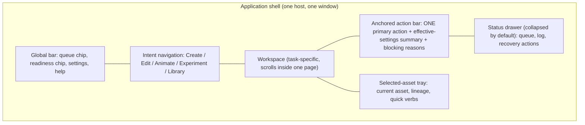
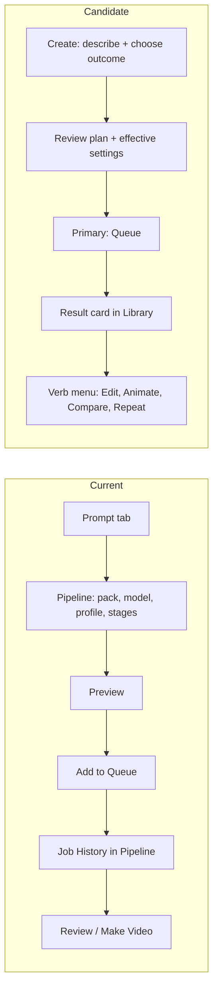
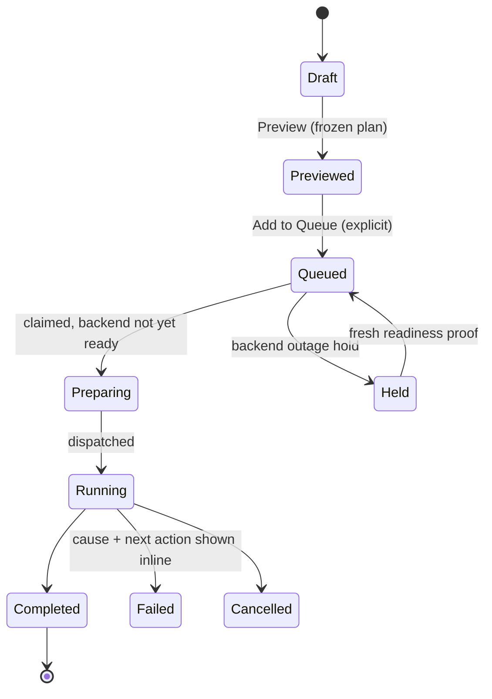

# Experience architecture (candidate)

**Status: PROPOSED hypotheses for testing. Nothing here is a decision.** Evidence tags per [README](README.md). The proposal is deliberately close to what already ships (EV-30) so that its marginal value can be tested rather than assumed.

## 1. Mental model hypothesis

An operator arrives with one of four starting points:

| Starting point | Typical question | Intent group (candidate) |
|---|---|---|
| Words/idea | "Make me an image of …" | **Create** |
| An existing asset | "Fix, extend, restyle or enlarge this." | **Edit / Improve** |
| A still or clip | "Make this move; join these shots." | **Animate / Make Video** |
| A question about settings | "Which setting/model is better for me?" | **Experiment / Learn** |
| A past result | "Find, compare, reuse, or redo that." | **Library / History** |

Queue/progress, readiness/diagnostics, application settings and AI assistance are **cross-cutting**: reachable from every group, owning no execution path (`AGENTS.md` §2).

**Delta from today.** Today: Create (Prompt, Pipeline) · Edit (Review, Photo Optimize) · Motion (Video Workflow, SVD, Movie Clips) · Learn · Advanced (HOLD). Candidate changes: (1) *Library/History* becomes a destination instead of a sub-panel of Pipeline; (2) Motion → "Animate"; (3) Learn → "Experiment" with Discovered Outputs moved toward Library; (4) the nine persisted tab IDs stay as *destinations inside* intent groups so saved UI state keeps working. **This may prove no better than the current grouping.** Test before adopting (VALIDATION T4): card sort, first-click test, and task-time comparison against the current shell on the same task scripts.

## 2. Candidate shell

Hypotheses: (a) the anchored action bar removes the "important actions below the fold" class (EV-17) without nested scrolling; (b) the status drawer reclaims the ≈95 px bottom zone while keeping queue state visible (EV-14); (c) the selected-asset tray replaces re-selection across Review/Photo Optimize/Video. Each is untested; (a) conflicts with the existing "page scrolls; it never squeezes" contract only if the bar itself is not fixed-size (GUI_STYLE_GUIDE §4 already keeps Save & Next in a fixed strip).

## 3. Flow candidates

Differences to measure (not assume): number of tab switches and clicks from idea to first result; clicks from result to a derived result; time to answer "where is my job?".

### Job state progression (all workspaces)

`Preparing` does **not exist today**. The owner accepted it on 2026-11-05 ("running versus held is already a confirmed confusion", DR-A10), so the diagram is now the intended vocabulary; it still resolves GP833-F1 (EV-09) only when a separate implementation package adds the lifecycle state. Outside this research.

## 4. State boundaries (no new authorities)

| Concern | Owner today [V] | Redesign rule |
|---|---|---|
| Draft/ephemeral UI state | `AppStateV2`, view-contract sessions | Stay toolkit-neutral; any shell must bind to these projections |
| Execution | Intent → Compiler → NJR → JobService → Repository → `run_njr` | Unchanged; primary action only submits via existing controller ports |
| Queue/History | SQLite `JobRepository` projections | Library and status drawer are *views*; no shadow state |
| Persisted UI state | `tabs.selected_tab_id`, legacy `selected_index` | Keep IDs; intent groups are presentation only |
| Media inspection | `MediaInspector`, `VideoPreviewWidget` | Reuse as the one inspector |
| Visibility policy | `content_visibility` | Takes precedence over local Show/Hide |
| Backend choice | Adapters/`ModelPolicy` | Only deterministic capability policy may choose; shown and overridable where legal |

## 5. Points where explicit user approval is required

1. Add to Queue / Queue Selected / Queue Sequence (frozen plan shown first). 2. Any experimental-workflow opt-in (per job). 3. Any overwrite or deletion of user assets (default: never overwrite originals). 4. Any AI-proposed plan (Tier 2) and any step-wise expansion (Tier 3). 5. Applying a recommendation or publishing a profile. 6. Launch/restart of a managed runtime; never an external one. 7. Telemetry enablement (VALIDATION, AI_GUIDED §6).

## 6. What already works and should be kept (counter-hypothesis)

Persisted stable tab IDs; the Video Workflow Basic/Advanced split and Make Video handoff; Learning's Design→Rate step bar; the shared `MediaInspector`; inline non-modal notices; frozen Preview before queue; whole-selection preflight; `FlowRow` wrapping action bars. A redesign that discards these needs a measured reason.

## 7. Open questions for the owner

Q1 Which of the five groups feels wrong or missing? Q2 Is Library worth a top-level slot? Q3 Is SVD a separate destination in the owner's mind? Q4 How much "tab memory" (where things used to be) matters to the operator today?
