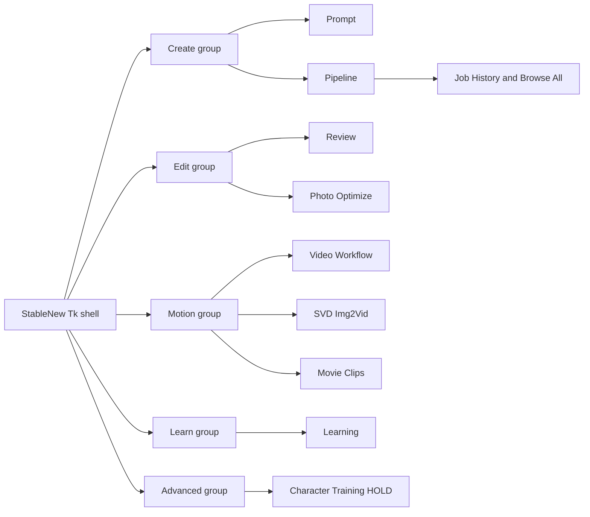
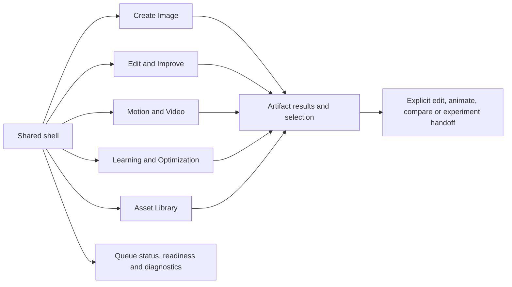

# Integrated experience — candidate design specification

**Design status:** proposed interaction architecture, grounded in source `3399f803`. No screen was implemented or prototyped. These are paper layouts and acceptance hypotheses, not screenshots or observed operator behavior. Product decisions are in `OWNER_DECISIONS.md`; implementation differences are in `DECISION_TRACEABILITY.md`.

## Current and proposed screen maps

Current production navigation (`E01`, `E02`):

Proposed destination map, preserving existing capability access:

The second map is a design proposal, not a change to production tab identities. The Library begins as a unified read projection over existing sources, with source badges and missing-file visibility. Supplemental collections metadata must not replace JobRepository. Character Training remains visibly held under an advanced route; Matrix, special studies, native SVD, Motion Library and expert settings remain reachable.

## Shared shell and interaction rules

Use one selected-workspace owner and a compact header: destination, current context and readiness summary. Put long diagnostics in an explicit details drawer; keep actionable refusal reasons beside the relevant action. Queue/running/held/attention details are projections of canonical state. A presentation label such as Preparing must not become a new durable lifecycle status by accident.

Each task has one visible primary action area. Use precise verbs: **Preview**, **Add to Queue**, **Save draft**, **Publish profile**, **Use as source**. Do not overload Run to mean save, compile and execute different things in different workspaces. Run Now continues to enqueue with immediate-start policy. Status remains visible while details expand; a scrolled body never moves a pressed button before release.

Preserve three identities in the view model: source identity, editable draft revision and frozen preview identity. A control/source change invalidates the executable preview; a late worker response cannot replace a newer draft. Selecting an artifact for inspection or changing workspace queues nothing. A handoff carries explicit source identity and asks before replacing unsent work. Cancel preserves both workspaces and navigation.

Show setting provenance compactly: **model policy**, **selected profile and revision**, **pack**, **temporary override**, **manual lock**. Distinguish a pinned control (presentation preference) from a locked value (application policy). Save scope is explicit and never inferred from the destination tab. A hard backend restriction blocks the conflicting action; uncertainty gets an honest untested/applicability label. It does not become a fictitious safety refusal or a silently ignored lock.

AI is an optional advisory layer. Show unavailable state and a manual route. Accepting a suggestion edits draft intent; it does not admit work. A future plan must still pass the same deterministic preview/admission boundaries. Existing AI-policy conflicts remain held.

## Five complete operator journeys

### 1. Create Image — PromptPack to reusable result

**Entry:** Create or explicit Library reuse. **Outcome:** an inspected artifact with its exact job recipe and clear next actions.

1. Open/create a PromptPack or recover an identified unsaved draft. If incoming work would replace edits, show Replace/Cancel; a recovery never silently overwrites a saved pack.
2. Author prompt slots/templates and optional Matrix, LoRA, embedding and stage prompts. Show the resulting job count and active source; retain the structured grammar.
3. Pick the model/profile. Show changed values and their source. Keep compatible manual intent according to the approved lock/precedence contract; explain unsupported values and require resolution.
4. Preview the effective jobs, count, immutable identities, resource/readiness warnings and save scope. If input or model changes, expire the preview. UX-DEC-004 confirmation semantics must be resolved before compressing this step.
5. Add to Queue through existing compiler/JobService. Disable duplicate submission while pending; retain draft and submitted job IDs if startup subsequently fails. Run Now uses immediate-start enqueue.
6. Follow canonical progress/hold. Backend unavailability shows the existing safe recovery route; it never creates an automatic unknown-outcome retry.
7. Inspect results in context; rate, compare, edit, animate or create a Learning draft through explicit handoffs. Recorded seed/readback limitations remain visible.

**Failure/restart:** preserve authoring draft separately from admitted jobs; recover job state from the repository, never by rebuilding a guessed job from the screen. Missing files show unavailable artifacts with retained recipe/lineage. **Acceptance:** T1/T2/T8/T9, exact Preview→NJR identity, no duplicate admit, cancel leaves source/draft unchanged.

### 2. Edit & Improve — verified source to compared child

**Entry:** Library/History image or explicit file import. **Outcome:** a derived artifact compared with its verified parent, without altering the source.

1. Select source(s); inspect identity/readiness. External files remain external and never acquire guessed job lineage.
2. Choose quick reprocess, spatial mask, Extend Canvas or Managed Photo Set. Explain that the managed working baseline is distinct from a future Preferred/Final designation.
3. Edit manually; optional Smart Review yields inspectable suggestions only. Decline/unavailable AI returns to manual editing. Named independent regions are a later capability, not simulated by silently merging prompts.
4. Preview exact source/mask snapshots, dimensions, preservation and policy. Any edit or source-byte change expires the preview.
5. Confirm admission once. Mixed batch refusals require excluding blocked items and re-previewing; there is no silent queue-good-items shortcut.
6. Open the result beside the verified parent and effective recipe differences. Missing/contradictory lineage is explained rather than guessed. Select working baseline only through the existing explicit promotion path.
7. Iterate as a new job/branch, preserving original/intermediate records. A future multistep plan must define dependency holds through canonical lifecycle before implementation.

**Failure/restart:** preserve unsent edit intent where supported; otherwise explicitly report a recovery gap rather than promising recovered brush strokes. Job recovery uses exact IDs; changed source bytes require re-preview. **Acceptance:** T3 plus byte-preservation, stale-source refusal, no-parent/no-compare case and incoming-handoff cancel.

### 3. Motion & Video — clip or Storyboard to assembled deliverable

**Entry:** Make Video on an artifact or Motion destination. **Outcome:** a reviewed clip/sequence and optional queued movie assembly.

1. Choose Quick Clip or Storyboard. Show source identity, supported workflow/version and approval status. Keep native SVD available without pretending it is interchangeable with every Comfy sequence.
2. For Quick Clip, set motion prompt and guided controls. For Storyboard, open/save a versioned linked draft, order 2–12 shots and set prompts/frames/anchors/seed intent.
3. Preview readiness, inherited settings, exact workflow version, missing/changed assets and experimental status. Authoring summary is not a frozen executable plan and does not promise resolved random seeds.
4. Queue through existing admission. Experimental consent belongs to the new job and is not restored as blanket approval from the saved draft. A sequence remains one immutable job with its existing segment ledger.
5. Play/review output. Interrupted same-plan work uses strict verified Resume; edits create a new full sequence today. Selective changed-shot reuse is visibly unavailable until its own contract exists.
6. Send selected output(s) to Movie Clips, order them, choose existing encoding settings and optional imported audio, preview and enqueue CPU assembly.
7. Inspect/export output with source/provenance. Preserve linked-media warnings; JSON export alone is not a portable media project. Timeline, titles/dialogue/lip sync and AI audio are future capabilities with separate evidence gates.

**Failure/restart:** reopen saved Storyboard; missing media remains linked/unresolved, revision conflicts require reopen/Save As, checkpoint resume verifies its pinned ledger. Never regenerate a changed source automatically. **Acceptance:** T5/T6 with fakes, changed workflow/media refusal, no experimental-consent inheritance, assembly creates a canonical job.

### 4. Asset Library — find, inspect and place without identity loss

**Entry:** Library destination or contextual picker. **Outcome:** the correct artifact is inspected and deliberately handed to a compatible task.

1. Choose source scope: generated jobs, managed photos or motion references. Present their original identities and current-file availability; do not copy jobs into a new History authority.
2. Search/filter using available metadata. Show bounded-search continuation. A full-prompt or semantic query must not silently act like a complete search when only summary prefixes are searched.
3. Inspect media, job recipe, lineage, annotations and applicability. Respect content-visibility policy before rendering/copying metadata or previews.
4. Select one or more compatible items and choose Edit/Animate/Compare/Experiment. Explain incompatible items; preview proposed placement before replacing existing task work.
5. Confirm handoff or cancel intact. Return to the same search/selection context after task completion.
6. For future collection removal/archive/delete, distinguish metadata removal from physical deletion and show dependency consequences. Until the owning disposition contract exists, do not expose an action that implies destructive capability.

**Failure/restart:** unavailable files retain records; relink requires identity verification. Exact duplicate bytes can share storage references without merging experiment/sample identities. First release need not include semantic search, general file deletion or folder monitoring. **Acceptance:** T4 plus source identity, bounded paging, empty/missing media and unsent-work replacement cancel.

### 5. Learning & Optimization — bounded study to approved reusable profile

**Entry:** model/profile context, selected result(s), or Learning. **Outcome:** inspectable evidence and an explicitly approved profile revision when eligible.

1. Pick a goal or structured study and freeze an independent baseline. Offer deterministic evidence/next-test advice; AI unavailable does not block study design.
2. Specify variables/prompts/seeds and disclosed scope. Show exploratory versus controlled limitations and the planned cost/count. Broader campaign budgets remain a later contract.
3. Build Preview; inspect immutable experiment/variant identities and model-policy restrictions. An approved experiment lock cannot be silently changed by profile selection.
4. Admit the bounded job batch canonically. Project progress and attention states; use exact-ID reconciliation after restart. Opening Experiment Library does not save/retry/rebind jobs.
5. Compare and rate results; preserve rating drafts separately from durable evidence. Latest rating revisions count each artifact once under existing rules. Missing readback stays uncontrolled.
6. Review findings, uncertainty, coverage/exclusions and differences from a prior profile. Separate personal preference from technical quality; absent AI scores remain absent.
7. Publish an eligible immutable Learning profile only after explicit confirmation. Refresh the existing selector without automatically selecting or favoriting it. Apply/reuse explicitly in Create and preview the resulting recipe.
8. If evidence is insufficient/conflicting, retain observations and propose a targeted follow-up draft. Imported research, evaluator calibration and autonomous stage progression remain separate research/authorization work.

**Failure/restart:** exact-job mismatches become Requires Attention, not inferred success or duplicate submission. A saved rating remains saved even if display refresh fails. **Acceptance:** T7, exact-job Library projections, duplicate-rating revisions, unqualified publication refusal, and round-trip selected profile→frozen job parity.

## Paper screen layouts and prototype priorities

These sketches specify regions and behavior. They do not prescribe a toolkit, exact pixel breakpoints or a new minimum window size.

| Screen | Top context | Main work region | Supporting region | Stable action area |
|---|---|---|---|---|
| Create | PromptPack/draft, model/profile revision, unsaved state | Prompt slots and basic generation controls | Pinned expert controls; results/recipe comparison | Preview; Add to Queue; save scope |
| Edit | Verified source and selected operation | Large image/mask/outpaint canvas | Operation settings; source/child/lineage tabs | Preview frozen edit; Add prepared job to Queue |
| Motion | Source, Quick Clip/Storyboard, exact workflow | Clip preview or ordered shot cards | Shot settings, readiness and library picker | Save draft; Preview; Queue Clip/Sequence |
| Library | Source scope and search/filter | Bounded gallery/list with explicit continuation | Media/recipe/lineage inspector | Contextual task actions; explicit placement |
| Learning | Model, goal/study, baseline identity and rigor | Design/Preview/Run/Compare/Rate progression | Evidence, findings and attention details | Build Preview; submit batch; save rating; review publication |

At narrower widths, turn inspector/settings into an explicit alternate pane; do not squeeze all columns or hide admission-required warnings. At short heights, compact secondary chrome and cap nested list height, retaining independent page scrolling and keyboard reveal. Never move controls between mouse press/release. Preserve unfinished content, selection and focus when switching panes.

Priority **S1:** shared shell/status/action behavior plus Create and its recovery path. **S2:** result→Edit/Library→Motion handoffs, including replacement cancellation. **S3:** Learning baseline→ratings→publication→Create. **S4:** advanced Motion timeline and campaign center after ownership and feasibility contracts. Cover every existing workflow route while emphasizing the first measured task, rather than implementing all five destination shells at once.

## Windows interaction and usability acceptance

Microsoft advises designing for the space available to the app window. Its effective-pixel guidance is XAML-specific; applying the window-space principle to Tk is a design inference and does not claim Tk has identical scaling behavior. [Microsoft window sizing guidance](https://learn.microsoft.com/en-us/windows/apps/design/layout/screen-sizes-and-breakpoints-for-responsive-design).

Keyboard traversal must be explicit and tested alongside visual order; pointer reachability does not prove keyboard access. This follows Microsoft's keyboard guidance; Tk implementation details still need direct testing. [Microsoft keyboard accessibility](https://learn.microsoft.com/en-us/windows/apps/design/accessibility/keyboard-accessibility).

Use existing theme/token and shared inspector contracts. Proposed component set: context header, source/identity badge, settings provenance row, bounded results list, status/attention notice, preview summary, explicit handoff review, fixed primary-action region and optional detail drawer. No new theme or pixel token is approved here.

Proposed acceptance checks for a later authorized baseline/prototype session:

1. All required actions/warnings reachable at the existing 1280×680 compatibility baseline, plus 1280×760 comparison. Record actual client size and display scale separately; do not adopt 760 as a minimum by assumption.
2. Tab/Shift+Tab can traverse and reveal all applicable controls; focus is visibly indicated. Include a partially clipped control under a stationary pointer and both press/release paths. No keyboard trap in nested lists or dialogs; Escape/cancel preserves work.
3. Wheel input at inner-list boundaries has defined page continuation; no hidden workspace scrolls. Capture scroll/focus evidence per container, not only screenshots.
4. No lost clicks, duplicate admissions, unannounced draft replacement or stale preview acceptance on the selected scripts. These are proposed release gates, not measured current counts.
5. Reuse approved T1–T9 unchanged. For before/after owner timing use the existing repeated, counterbalanced n=1 protocol; report medians/ranges and practice effects. Add coverage fixtures without silently rewriting the approved scripts.
6. Compare task completion, navigation/backtracking and action reachability against the same current-SHA baseline. Numeric improvement targets are chosen after the baseline, not fabricated now. An outcome with no measured benefit does not justify a rewrite.
7. Real 125%/150% scaling remains separately authorized; this package does not change global Windows scaling or access the owner's running app. A simulated font/scale exercise is labelled simulation, not real DPI evidence.

Existing B2/B3/B5 evidence is loopback/fake-backend, historical SHA and limited display conditions. Reuse it for experiment design and known hazards, not as today's desktop acceptance. No accessibility certification, observed task-time improvement or new qualification verdict is claimed.
