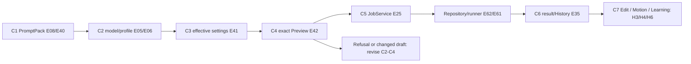
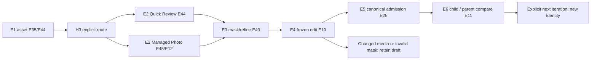
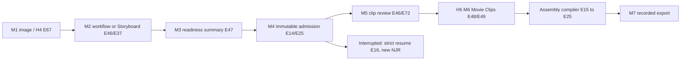
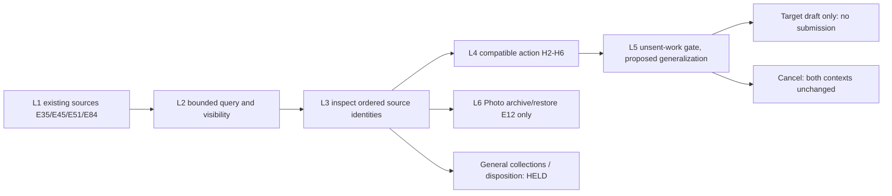
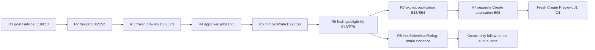

# Five PROPOSED operator journey specifications

These refine, rather than restart, [R1's proposed journeys](../ux-850-r1/EXPERIENCE_DESIGN.md) against accepted A. Every action below is **PROPOSED interaction behavior** unless explicitly identified as an existing mechanism. Existing implementation anchors do not prove the proposed complete experience. Shared verbs follow [interaction semantics](INTERACTION_SEMANTICS.md); H numbers identify [handoff contracts](HANDOFFS.md). All E numbers refer to [A's exact-source index](../ux850-a/SOURCE_INDEX.md), applicable as described in [validation](EVIDENCE_AND_VALIDATION.md).

## J1 Create — Prompt/PromptPack to inspected result

**Entry / exit:** Create → Prompt for structured authoring, or Pipeline for already chosen packs/working settings; exit with admitted job IDs and an inspected recorded artifact, or a retained draft plus explained refusal. Model choice is explicit; a recommendation is advisory. N1 preserves two destinations rather than claiming an implemented single form.

| Step / operator action | Proposed feedback and state boundary | Existing anchor / missing extension |
|---|---|---|
| C1 Open/new PromptPack or deliberately reuse a result recipe | Name the pack and save association; incoming unsent work uses H1/H2 cancel/replace. Empty: New PromptPack or Open existing; no example job silently queued | E08/E40 Prompt workspace; E39 pack grammar/storage; general unfinished-draft recovery remains incomplete |
| C2 Write prompt, choose model and profile | Basic route shows essential prompt/model/profile and material differences. Keep selected model under operator control; show unsupported versus untested | E05/E06/E69 profile/model policy; provenance/locks need the retained F1 decision |
| C3 Inspect effective settings and save scope | Show pack settings versus current job overrides, active optional stages, count and changed-value explanation. Saving a pack or defaults is separate from applying working values | E09/E39/E41/E81; proposed lock scope does not yet exist |
| C4 Build Preview | Show actual compiled jobs, pack expansion/count, effective prompt/settings, exclusions/refusals and freshness. A changed control expires executable approval. If zero jobs compiled, show reasons and return to authoring | E41/E42 existing builder/Preview; current builder can skip unavailable pack entries, so do not call every Create preview all-or-none |
| C5 Add to Queue, or current Run Now policy | Submit only the accepted prepared snapshot via JobService. Show exact admitted IDs and queued/immediate-start distinction; disable duplicate pending action | E25/E62/E75; F4 fast-path conflict remains unresolved; no adaptive one-click bypass proposed |
| C6 Follow progress, then inspect result | Existing queue/history projections show queued/running/held/failed outcome. A missing image retains job/recipe with an unavailable reason; media-hidden state offers the existing deliberate visibility control | E35/E38/E42/E62; rendering a preview image is not generating one |
| C7 Continue from result | Edit H3, Make Video H4, Learning H6, or supported Regenerate with Changes H2; each creates new intent and leaves the original job intact | E67/E78; proposed common action vocabulary spans existing separate views |

**Advanced route:** stay in Prompt for slots/templates, Matrix, LoRAs, embeddings and global/ADetailer policy; Pipeline retains stage cards, Refiner/Hires and advanced/legacy img2img disclosure. Summarize enabled hidden controls. Pinnable controls, scoped locks and AI approved plans are visible design extensions in the coverage table, never simulated by suppressing advanced controls. An accepted AI suggestion edits draft text only; unavailable AI leaves manual authoring usable (E23/E74).

**Failure/recovery:** incompatible profile leaves an explanation and manual choice; no silent unlock. Late Preview cannot replace a newer draft. Admission failure retains intent and any known admitted IDs; uncertain dispatch is not retried. On reopen, distinguish saved pack/defaults from an unrecovered temporary draft; consult the repository for submitted jobs. Do not promise general autosave. If a save succeeded but refresh failed, report that distinction before offering another save.

**Final evidence / paper acceptance:** the result links to its job/recorded recipe and source pack only if pack-sourced. Check C4→C5 snapshot parity, material-change invalidation, zero/partially compiled preview disclosure, H1 cancellation and no automatic resubmission. Success/time, actual accessibility and real output quality are unmeasured.

## J2 Edit — selected asset to compared derived result

**Entry / exit:** select a still image from an existing artifact view or explicitly import a file. Exit with a new derived job/artifact and supported comparison, preserving the original. An external file has source provenance, not invented JobRepository ancestry.

| Step / operator action | Proposed feedback and state boundary | Existing anchor / missing extension |
|---|---|---|
| E1 Inspect/select asset(s) | Show source identity, availability, type and parent provenance; empty Review offers select/import, empty Photo offers explicit import | E44/E45; source-appropriate selection and whole-selection preflight |
| E2 Choose Quick Edit or Managed Photo Set | Quick routes to Review for reprocess/mask/outpaint; managed route invokes Photo's own import/scope policy, not an implicit baseline promotion | E43/E44/E45/E12; H3 |
| E3 Mask/refine | Manual brush/canvas is the default. Optional Smart Review mask/caption suggestions can be inspected, corrected or declined. Show source dimensions and selected region | E43/E66/E10; independent named regions/per-region settings remain an extension |
| E4 Preview derived work | Display exact source/mask snapshot, output dimensions, prompt/settings and actual preservation policy. Hash/source/mask changes require a fresh preview | E10; outpaint original-pixel restoration is proven statically, not a universal preservation guarantee for every edit mode |
| E5 Submit derived job(s) | Keep selected-set refusals visible. Review whole-selection admission must be repaired/re-previewed or explicitly narrowed; no silent queue-good-items shortcut | E25/E44; no second batch lifecycle |
| E6 Compare and choose next action | Supported direct-parent History comparison uses frozen diffs and verification labels. Managed Photo candidate promotion changes only its Working Baseline via existing explicit action | E11/E38/E12; arbitrary recursive branch comparison and universal Preferred/Final remain proposed |

**Advanced route:** scope-aware managed per-photo candidates/reprocess and manual mask/outpaint remain accessible. Future named regions, review-point plans and independent branches get dedicated authoring/review sections only after their contracts exist; do not flatten region settings or display an executable plan that no compiler understands. A new plan would compile into canonical jobs, never run from the screen.

**Failure/recovery:** incoming Review cancel keeps source selection and brush intent and leaves navigation unchanged where the current guard exists; generalized guard extension is proposed. Missing or changed bytes block preview/compare; wrong/missing parent yields a reason, not a nearest-image guess. Stale Photo baseline writes use the store conflict path. Interrupted submission consults exact job IDs; a failed child never rewrites the parent. After restart, only actually persisted Photo state is recoverable; unsaved mask recovery is not guaranteed.

**Final evidence / paper acceptance:** retained original + recorded child provenance + compared pair with verification limitations. Test on paper: source changed after mask, mixed unsupported selection, cancel incoming edit, stale baseline save, missing parent, AI unavailable and mask preview arriving late. A working-baseline promotion does not mark Preferred/Final or publish learning evidence.

## J3 Motion — image or Storyboard to reviewed/exported clip

**Entry / exit:** Make Video from a verified image, or Motion → Video Workflow / SVD / Movie Clips. Exit with a recorded reviewed clip/sequence and optionally a separately queued assembled movie. A JSON Storyboard export links media; it is not a portable media package.

| Step / operator action | Proposed feedback and state boundary | Existing anchor / missing extension |
|---|---|---|
| M1 Choose source and route | H4 carries image provenance and approved workflow defaults; Quick Clip is ordinary route. Empty: Select image or Open/New Storyboard. Native SVD remains explicitly separate | E46/E67; no blanket equivalence between backend capabilities |
| M2 Author motion | Basic: workflow, motion, length, prompt. Advanced: current settings, motion driving reference, or 2–12 ordered Storyboard shots with seed/anchor intent | E46/E47/E37/E13; workflow/version and driving compatibility are explicit |
| M3 Inspect readiness/summary | Show source/hash/version, approved/experimental status, resource refusal and unresolved settings. Storyboard summary does not freeze random seeds or claim a final executable NJR | E14/E47; recorded media changes need explicit Accept Current Media and save; no automatic accept |
| M4 Queue Clip/Sequence | Existing compiler/admission resolves executable plan. Sequence is one job with internal segments. Experimental opt-in belongs to this job; a saved draft cannot restore consent | E14/E25/E80; handler remains behind run_njr |
| M5 Play and review | Show recorded output, requested motion, action outcome and optional quality ratings separately; unavailable file is visible. Resume only when exact-plan checkpoint validation succeeds | E46/E72/E16; edited Storyboard currently needs new full execution |
| M6 Send selected clips to Movie Clips | H5 preserves order/provenance; inspect sources, duration/transition, recommended existing encode profile and optional imported audio; detailed encoding stays available | E48/E49/E15; Build submits canonical assembly, not an untracked CPU shortcut |
| M7 Inspect assembled export | Show output path/provenance, Open/Reveal and review outcome; linked source availability and export profile remain inspectable | E15; new titles/dialogue/lip sync/AI audio/portable packaging remain separately gated |

**Advanced route:** saved/reordered/duplicated Storyboards, motion references, existing experiments and native SVD postprocessing/encode settings. Continuity profiles, precise timelines, temporal ranges/keyframes beyond existing anchors, selective suffix regeneration and audiovisual plans are mapped extensions; no hidden unavailable renderer is implied.

**Failure/recovery:** stale Storyboard revision → reopen or Save As; malformed/unknown JSON is not rewritten. Missing media may remain in a saved draft but blocks admission. A replaced workflow requires explicit adoption and re-preview. Failed segment → inspect ledger/eligible strict Resume as a new job, otherwise explain why refused. Changed-plan reuse is unavailable. Uncertain POST never auto-replays; do not restart external Comfy. Assembly failure retains source list and canonical failure record. General continuous autosave and crash recovery are unverified beyond actual stores.

**Final evidence / paper acceptance:** clip hash/recorded job + quality review separated from run success; assembly has its own job/output. Challenge changed-source summary, reopened experimental draft, missing segment artifact, mixed unsupported Storyboard settings, failed handoff to Movie Clips, and missing audio. These paper traces provide no video quality or physical qualification verdict.

## J4 Library — discovery to deliberate placement and recoverable disposition

**Entry / exit:** existing History/Browse All, Photo results, Motion Library, Learning discovered outputs, or a contextual source selector. Exit with an identified artifact deliberately placed in a compatible workspace, or an explained no-op. **PROPOSED unified Library experience:** the complete single catalog/collections journey is not currently implemented and is not supplied by renaming these views.

| Step / operator action | Proposed feedback and state boundary | Existing anchor / missing extension |
|---|---|---|
| L1 Choose source scope and discover | Name source owner and search limits; generated History queries, managed photos, motion references and observational groups remain distinguishable | E17/E35/E45/E50/E51/E82–E84; unified query/folder approval is a future contract |
| L2 Search/filter/inspect | Show page/continuation and metadata coverage. History searches bounded prompt prefix/model, not full text. Empty scope: select another source or explicit import; zero matches: clear filters | E17/E35; semantic/similarity search unavailable unless separately qualified |
| L3 Select and organize | Retain ordered source IDs, availability and verification badges. Proposed collection membership is a reference to originals, never a copied job or independent sample | E50 aliasing and E83 grouping are narrower foundations; general collections/tags/favorites are separately gated |
| L4 Choose contextual placement | Edit H3, Animate H4, assemble H5, experiment H6 or supported parent compare/variation H2. Validate the entire chosen set against destination capabilities and explain blocked items | Existing E11/E67/E78 and source-specific services; no generic arbitrary-media compare promise |
| L5 Review incoming work and place | Describe copied/preserved/reset values, detect destination unsent work and ask Replace/Cancel; cancel leaves source query/selection and destination intact. Return link restores in-session browse context where possible | Generalized H contracts are proposed; only source-verified guards are credited as existing |
| L6 Archive/recover if supported | Use Photo's existing archive/restore only for its scope; explain exact effect. General remove-from-collection/archive/delete controls remain unavailable until dependency/disposition policy is approved | E12/E45; Motion Library has no destructive source deletion; no new filesystem operation |

**Advanced route:** contextual selection across source types with explicit compatibility review; generated-output rescan/grouping already exists in Learning. Future approved-folder scan, similarity groups and semantic search require separate source/trust/qualification rules. Exact byte duplicates must not merge job, study or sample identities.

**Failure/recovery:** a missing file retains its catalog/History record and references; relink/verified replacement uses owning service, not path guessing. Interrupted import shows linked/managed status and actual outcome; do not claim file copied if only linked. A future archive must show dependency effects, reversible restore and unavailable media; until decided, explain “not supported in this source” and offer browsing/export information rather than deletion. Cancel a handoff before any destination mutation. Do not infer cross-restart query/selection recovery from a saved tab ID.

**Final evidence / paper acceptance:** source identity, chosen action and target draft acknowledgement, plus an archive/restore record only where actually supported. Challenge empty index versus empty filter, hidden media, same bytes in two experiments, source vanished during selection, mixed types, destination closed and cancel replacement. The full durable-collection/general-archive outcome stays held; its absence is visible, not presented as acceptance of UX-DEC-035/041.

## J5 Learning — research goal to findings and explicit profile reuse

**Entry / exit:** Learning goal/design, current model/evidence advice or selected outputs H6. Exit with stored experiment/job associations, reviewed ratings/findings, and either an eligible immutable profile explicitly published then applied, or a visible insufficient-evidence outcome and create-only follow-up draft.

| Step / operator action | Proposed feedback and state boundary | Existing anchor / missing extension |
|---|---|---|
| R1 Set goal and choose design | Ordinary: one-variable controlled question or inspect existing next-test advice. Empty: New / Open experiment / scan existing outputs; scans are observational, not controlled trials | E19/E52/E57/E82; optional AI planning unavailable must leave manual route |
| R2 Set independent baseline and variables | Display model identity, question, variables, prompt/seed cohort and exclusions. Copy Pipeline settings only deliberately/initially as current contract permits, never as a live binding | E36/E52; approved research configuration differs from Create's temporary values |
| R3 Build and inspect Preview | Freeze the design's applicable baseline/variants, count and readiness; distinguish exploratory from controlled and disclose missing readback. Changed design requires new preview/approval | E36/E73; campaign budgets/window/repair policy are not implied by bounded batches |
| R4 Approve and queue | Existing study/batch admission path and exact associations; show per-experiment/batch outcome and uncertainty. Current study types have different atomicity scopes; no invented all-studies transaction | E25/E36/E73; no automatic scheduling or continued authorization |
| R5 Compare/rate/save | Present paired/available artifacts and current ratings once per revision. Save drafts explicitly; show saved evidence separately from display refresh. Absent outputs/seed/readback are exclusions, not zero quality | E22/E53/E55/E56; no automatically invented AI or technical score |
| R6 Review findings | Explain controlled/local scope, coverage, uncertainty and eligibility. Keep preference versus technical assessment separate; conflicting studies remain separate where comparability is unproven | E18/E19/E79; UX-DEC-071 methodology and pending 072 sufficiency remain gated |
| R7 Publish eligible profile, then explicitly reuse | Explicit confirmation revalidates evidence and creates immutable profile revision. Selector refresh does not select/apply/favorite. H7 moves to Create for explicit selection/application and fresh Preview | E18/E54/E77/E05/E07; profile publication, favorite, application and qualification are distinct |
| R8 Insufficient or stale evidence | Save observation/findings, explain gap and propose create-only targeted follow-up; no silent profile replacement or auto-generation | E19/E57/E73; imported research/evaluator/campaign behavior remains proposed |

**Advanced route:** existing Model Comparison, Two-Axis Grid, Prompt Slot, LoRA Composition, Embedding and Prompt × Model studies, Experiment Library, discovered reviews, qualification batches and profile detail. Preserve their local-only/no-publication rules; ordinary ratings never promote every study type into settings evidence. Cross-model results remain scoped and do not invent a global winner. Research campaigns/evaluator releases have visible future homes in coverage but no active controls until authority is defined.

**Failure/recovery:** reopen saved experiment and reconcile exact repository jobs before any retry; Requires Attention is a research projection, not a new JobRepository status. Admission uncertainty never authorizes resubmission. Changed checkpoint/profile/evidence invalidates applicability; preserve historical records and show operator-controlled fallback. A save error must distinguish durable failure from refresh failure. Corrupt draft/import and unsupported publication explain recovery without rewriting evidence. Losing approval after restart blocks unattended continuation.

**Final evidence / paper acceptance:** exact experiment/batch IDs, job/artifact associations, saved rating revisions, conditional findings and eligible immutable profile revision plus separately confirmed Create application. Challenge duplicate ratings/imports, partial admission, unknown job association, no eligible profile, preference/technical disagreement, stale model identity, and publication refresh without application. No conclusion sufficiency threshold or qualification is created here.

