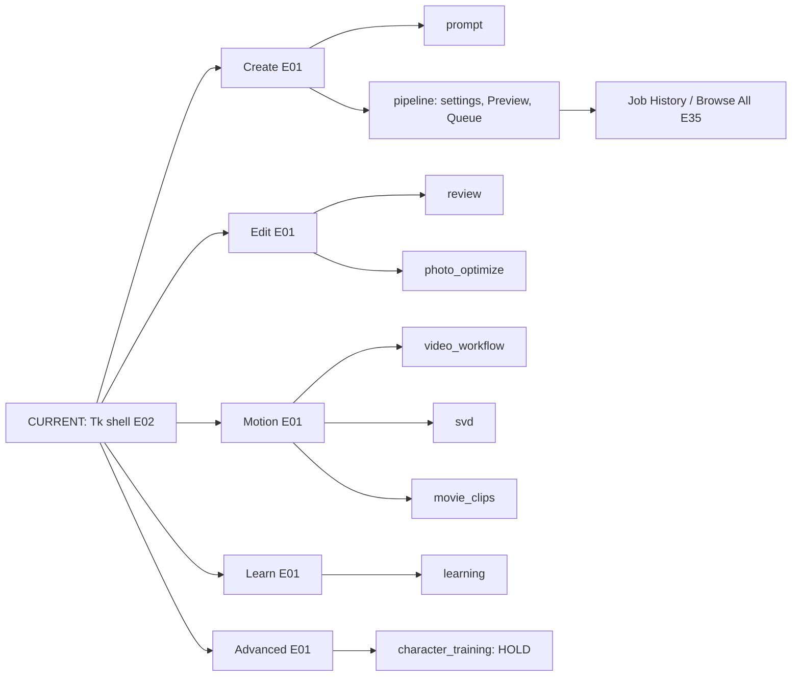
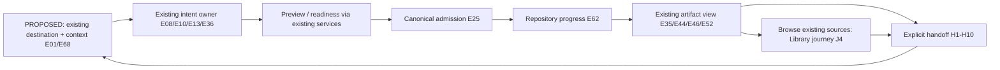

# Current → PROPOSED navigation and layout

## Current source contract

The current Tk shell uses one notebook. `_tab_registry` owns tab identity, the notebook owns selection, and task groups are presentation only ([A E01/E02/E68](../ux850-a/SOURCE_INDEX.md#e01)). Exact persisted creation order is:

`prompt, pipeline, learning, review, photo_optimize, movie_clips, character_training, svd, video_workflow`.

Preserve all nine IDs, that order, `pipeline` default, failed-tab placeholders/disabled destinations, native-strip fallback and Ctrl+Tab / Ctrl+PageUp/PageDown. Preserve the actual startup resolver: a known available stored ID wins; the numeric fallback is considered when the ID key is absent or non-string; an unknown string goes to the normal default, not a guessed legacy destination. Continue writing the legacy index for older builds. This precision follows `resolve_startup_tab_id`, rather than broadening its docstring into new compatibility behavior.

| Current route | PROPOSED option N1 presentation over the same owner | Access to advanced work |
|---|---|---|
| Create → Prompt (`prompt`) | PromptPack authoring: slots/templates, explicit save scope, next action to configure/preview | Matrix, LoRAs, embeddings, global/ADetailer prompts remain in authoring |
| Create → Pipeline (`pipeline`) | Model/profile + effective settings + Preview/queue/results; one visible context summary | Stage cards and advanced/legacy settings remain reachable; active values summarized when collapsed |
| Edit → Review (`review`) | Quick/spatial editing of explicit source selection | Manual mask/outpaint, opt-in Smart Review, reprocess settings |
| Edit → Photo Optimize (`photo_optimize`) | Managed Photo Set route with per-photo baselines/candidates | Scope-aware batch work, explicit promote/revert/archive/restore |
| Motion → Video Workflow (`video_workflow`) | Quick Clip by default; explicit Storyboard switch/section | Existing Multi-shot sequence, workflow options, Motion Library and experiment review |
| Motion → SVD Img2Vid (`svd`) | Named native SVD route, with its own readiness/limitations | Existing postprocessing and export controls |
| Motion → Movie Clips (`movie_clips`) | Ordered assembly and export | Existing encode profiles, transitions, imported audio and detailed encoding |
| Learn → Learning (`learning`) | Goal/design → frozen study preview → review/findings → explicit Create reuse | Existing study types, catalog, discovered outputs, experiment library, publication and evidence detail |
| Advanced → Character Training (`character_training`) | Retain visible HOLD and reason; no executable shortcut | Trainer decision still required |
| Pipeline → Job History/Browse All | Retain canonical browser; use consistent contextual action names in artifact views | Direct-parent comparison and supported iteration, bounded search/paging |
| Header settings / queue status | Keep current owner; contextual readiness/refusal + explicit details | Engine defaults and diagnostics remain distinguishable from working settings |

The Library **journey** spans History, Photo, Motion Library and Learning discovered outputs. In N1 it is entered through those existing routes; there is no new tab or claim of an existing cross-source catalog. A common picker or source-switching browser is a later, approved read-only projection. Do not turn a presentation label “Library” into a durable job/collection owner.

## Two viable alternatives

**N1 — strengthen existing task groups and contextual routes (RECOMMENDED RESEARCH).** Keep navigation order and stable IDs. Add clearer route descriptions, in-place Basic/Advanced disclosure, current-source/unsaved/effective-settings summaries and consistent handoff/recovery feedback. Artifact selection stays with its current view; a deliberate action leads to the destination. A “Find existing result” affordance, if later approved, opens existing History rather than manufacturing a Library tab. Save buttons state their actual scope. Cross-workspace progress links expose existing queue state. These are proposed presentation improvements, not findings that all corresponding UI is absent.

**N2 — session-only journey guide beside existing workspaces.** Keep the same groups/IDs/notebook and add a collapsible guide: Choose source → Configure → Preview → Queue → Review. Each step selects an existing workspace or focuses a panel through existing presentation actions. The guide computes readiness from current projections, holds no independent execution status and persists no step or selection. Dismissing it leaves current work intact. A Library task in the guide links to the available source-specific browsers. This is feasible without a tenth destination or a new scheduler, though the guide still requires a separately approved implementation and focused UI contract tests.

| Criterion / tradeoff | N1 existing groups + contextual routes | N2 session-only journey guide |
|---|---|---|
| Ordinary Create/Edit | Familiar controls with clearer next action; handoffs need visible wording | Stronger step guidance; risks splitting attention between guide and workspace |
| Advanced studies and Motion | Direct access preserved, fewer forced linear steps | Guide must branch for Storyboards, studies and assembly; can become a second navigation tree |
| Re-entry after restart | Existing tab restoration and store-specific reopen, no fabricated completion | Must derive every step from current state; cannot imply recovered guide progress |
| Layout/accessibility | Can improve compact regions incrementally; existing problems remain unmeasured | Extra rail consumes width; collapsible/focus behavior must be proven on Windows |
| Ownership/correctness | Least additional presentation coordination; handoff contract still needs repair/extension where absent | More synchronization/late-response cases despite no new durable authority |
| Library discovery | Source-specific browsing remains fragmented; common labels help only partly | A source chooser makes routes visible but still is not a unified search/catalog |
| Total successful-work cost | Smaller coupled change and regression surface, builds on A's verified bindings | Potential onboarding gain, higher cross-workspace validation cost and risk of guide drift |

Select N1 as the research recommendation because it addresses continuity with the fewest new synchronized surfaces under existing owners. This is a reasoned hypothesis, not measured preference or time savings. N2 wins if authorized operator trials show that explicit step guidance materially improves task completion enough to justify the extra surface. Reject both if measured navigation is already effective and the main problem is a specific broken control.

## PROPOSED layout grammar, common to either option

| Region | Ordinary view | Advanced/detail access |
|---|---|---|
| Context header | Source, destination, draft/unsaved status, model/profile identity | Provenance, exact revisions, evidence and compatibility explanation |
| Work region | Task's smallest useful control set; visible selected source | Existing structured authoring, stage settings and special studies; pinned controls remain a gated new preference |
| Result/selection region | Current artifacts with source badges and explicit task actions | Existing parent compare, metadata, rating and export details |
| Action region | Distinct Preview / Add to Queue / Save scope; inline progress/refusal | Detailed diagnostics; no hidden enabled stage or active override |

No pixel breakpoint, supported-size change, toolkit choice or new global state store is decided. Preserve content visibility for every thumbnail/detail/copy path and keep async queries latest-request-wins under GUI ownership. The following diagram is a proposed routing grammar, not a new runtime component:

E references in both diagrams resolve through [A's unchanged exact-source index](../ux850-a/SOURCE_INDEX.md). The proposed common browser, durable collections or a dedicated Library destination are future decisions; they are not prerequisite to applying N1's contextual grammar.
