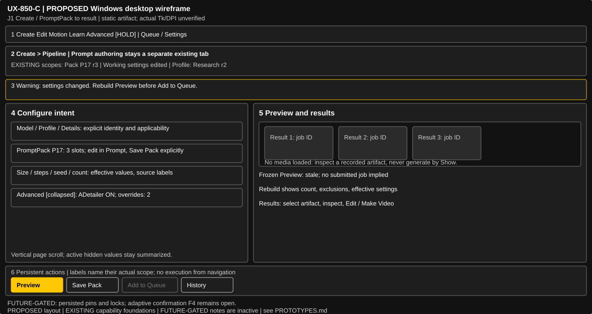
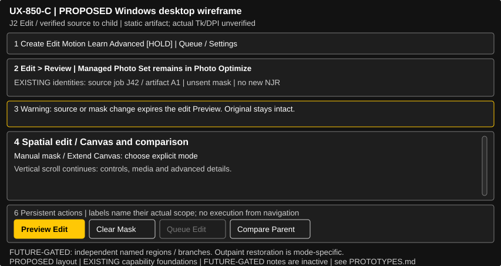

# Five journeys — inspectable research wireframes

Every SVG is UTF-8 text with a viewBox, title/description, plain labelled groups and `data-component` / `data-status` annotations. Edit shapes/text directly in the repository; no generated-code/runtime dependency or production import is required. These are **static low-fidelity layout prototypes**, not screenshots or interactive Tk simulations. Neutral placeholders deliberately contain no user media. All P17/J42/S8/E7 and revision values are synthetic examples, not actual records or new identifier formats. Every arrangement is PROPOSED; EXISTING labels identify foundations and FUTURE-GATED notes are inactive prose.

Shared annotation numbers: **1** existing navigation groups; **2** source/draft/revision context; **3** persistent actionable notice; **4** scrollable work/settings; **5** inspection/result region (stacked within 4 in compact); **6** fixed action strip. Gold indicates one proposed primary action. Muted unavailable actions are also marked `data-state="disabled"`: Create/Edit submission needs fresh Preview, and missing History media blocks Edit/Make Video. Other depicted availability is schematic: real eligibility, pending/stale and refusal states must follow the owning service; showing a Queue button never proves a valid executable plan exists.

| B primary journey / prototype | 1280×680 logical client | 853×453 compact stress client | Default / advanced / gate |
|---|---|---|---|
| J1 Create | [01 wide](prototypes/01-create-wide.svg) | [01 compact](prototypes/01-create-compact.svg) | Model/profile, selected pack and effective settings visible; author in existing Prompt tab. Matrix/stages/overrides disclosed; pins/locks/adaptive confirmation held |
| J2 Edit | [02 wide](prototypes/02-edit-wide.svg) | [02 compact](prototypes/02-edit-compact.svg) | Manual mask/Extend Canvas and source identity; Smart Review optional; independent regions/branches held |
| J3 Motion | [03 wide](prototypes/03-motion-wide.svg) | [03 compact](prototypes/03-motion-compact.svg) | Quick Clip/Storyboard within existing Video Workflow; native SVD and Movie Clips distinct. Existing encode profiles available; timeline is future prose |
| J4 Discover | [04 wide](prototypes/04-discover-wide.svg) | [04 compact](prototypes/04-discover-compact.svg) | Existing Pipeline History/Browse All, source-specific search; no new Library navigation. Unified catalog/collections/delete held |
| J5 Learn | [05 wide](prototypes/05-learn-wide.svg) | [05 compact](prototypes/05-learn-compact.svg) | Independent study baseline, ratings/findings; advanced studies/discovery remain reachable. Campaign/evaluator and 072 held |

## Annotated transition traces

| Screen / B steps | What the prototype means | Required next/negative state (future interaction test) |
|---|---|---|
| 01 / J1 C1–C3, H1 | Context retains pack revision, temporary working edits and profile separately; Save Pack names its actual scope | Edit Prompt in the existing tab and return; do not overwrite pack/defaults merely by selecting a profile. Advanced header keeps active ADetailer/overrides visible |
| 01 / J1 C4–C7 | Notice is a stale Preview example, not an admitted job. Rebuild Preview first; existing compile exclusions/count are shown | Add to Queue remains unavailable for stale/pending intent, with reason; successful admission shows exact IDs. On ready state primary emphasis can move from Preview to Add to Queue without changing semantics |
| 02 / J2 E1–E5, H3/H9 | Placeholder represents canvas/source-pixel editing and verified direct-parent comparison, never an unrestricted gallery compare | Changing source/mask expires edit preview. Incoming source replacement uses existing guard where present and future generalized no-op-on-cancel elsewhere; mask undo does not mutate original. Outpaint-only restoration claim stays scoped |
| 03 / J3 M1–M5, H4/H8 | “Summary” intentionally says readiness only; ordered shots reference a revisioned Storyboard, not a frozen executable plan | Changed media requires explicit adoption/save; per-job experimental opt-in is not restored from a draft. Queue Sequence uses existing admission. Strict unchanged-plan Resume remains distinct from editing and regenerating |
| 03 / J3 M6–M7, H5 | Movie Clips button is a deliberate route to the existing assembly tab; ordered sources retained | Inspect encode profile, optional imported audio and source list there; Build creates a canonical queued assembly job. No conceptual timeline control, lip-sync or automatic build is implied |
| 04 / J4 L1–L5, H2–H6/H9 | Source label says History; missing-file notice keeps the job/artifact identity | Clear filters differs from import/create; selection alone loads no hidden bytes and queues nothing. Missing/incompatible Edit/Make Video is refused with reason; generic unsent-work cancellation is still target behavior |
| 04 / J4 L6, H10 | No Delete/collection action is drawn | Existing Photo archive/restore is available only in its own scope. This prototype does not complete the full Library outcome |
| 05 / J5 R1–R5, H6 | Baseline, experiment and rating revision distinct; preview/ratings/save/findings do not collapse into one Run action | Reconcile exact jobs before retry; missing/readback exclusions, controlled versus observational evidence and current rating revision remain visible. Durable save success with refresh failure is not shown as unsaved |
| 05 / J5 R6–R8, H7 | Insufficient evidence is a legitimate outcome; profile Details is not automatic publication/application | Eligible publication is explicit, then separate Create selection/application and fresh Preview. Local-only study restrictions remain. No confidence percentage or conclusion threshold is invented |

## Visual samples

The compact drawings show the first part of one vertical body plus an explicit continuation, not every control squeezed into one viewport. Detailed content retains natural height and is reachable by scroll/focus; action strip and warning summary remain outside that body. SVG bounds validate only the drawn view. The future acceptance plan must measure every scrolled/expanded control in actual Tk, including transient dialogs and detached media.

## Conceptual extensions — deliberately inactive

- **Future timeline:** ordered media concept with source identity, duration and unresolved temporal-edit policy. Existing Storyboard rows and Movie Clips order are the usable foundations; a labelled note is the only timeline representation here.
- **Future campaign dashboard:** prospective research question, coverage, exclusions, uncertain findings and approved-plan references. No active Run/Pause/Resume, scheduler, budget or evaluator gauge is depicted; approved contracts and sufficiency methodology are prerequisites.
- **Future common discovery:** possible source switch/read projection after an approved contract; durable collections, import trust and disposition need separate decisions. Current prototype remains in History.

These notes provide design placement without authorizing implementation, persistent identifiers, new platform scope or runtime ownership.
