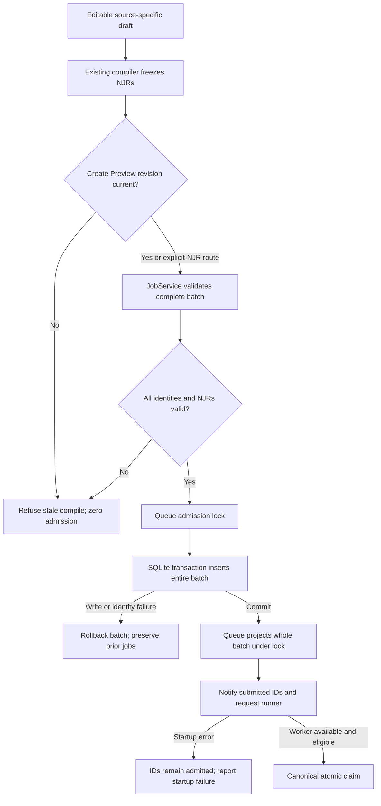
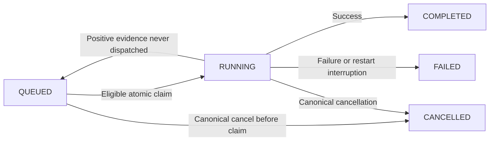
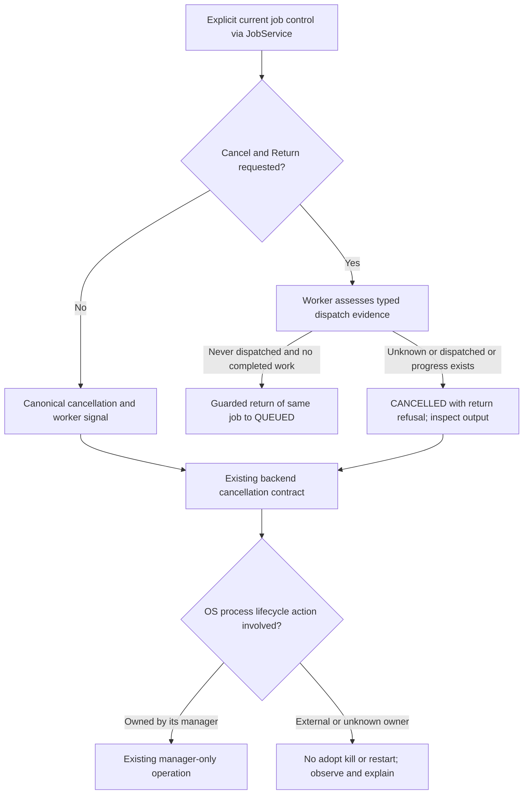
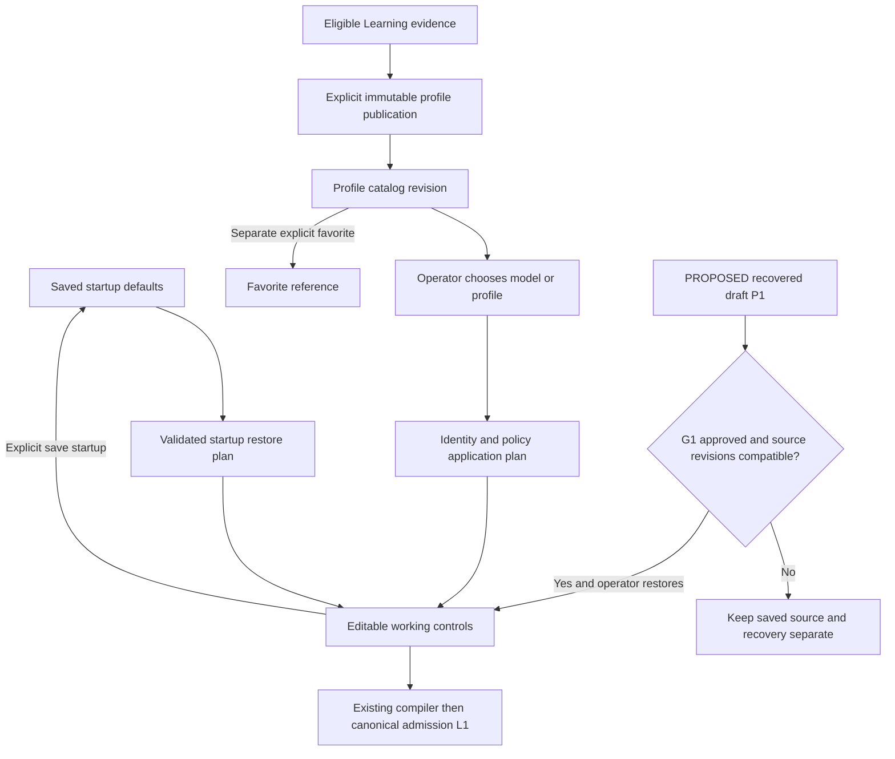
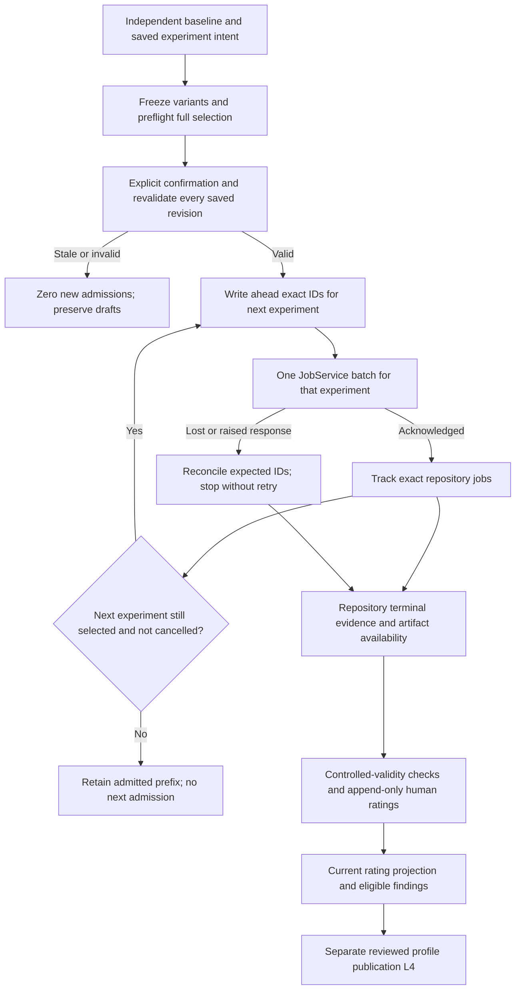
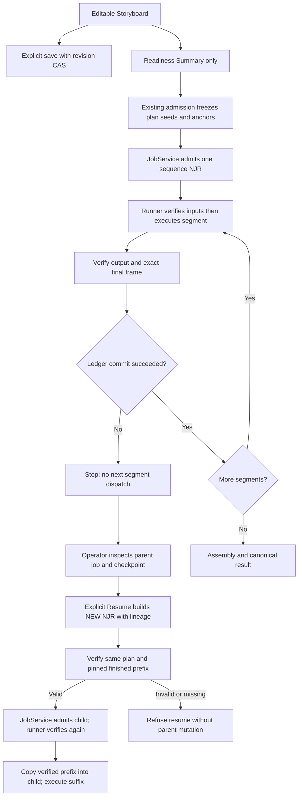
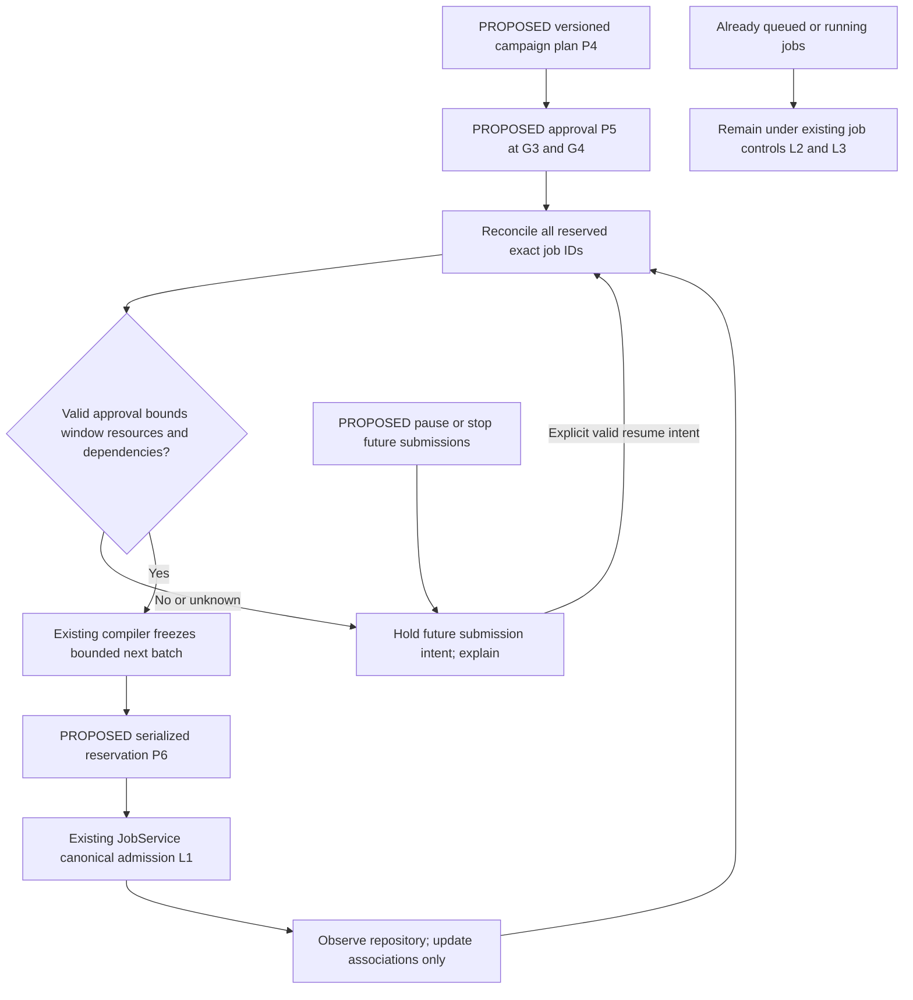
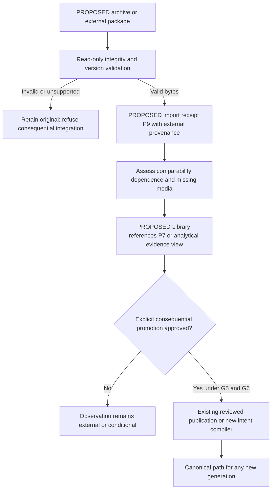

# Lifecycle diagrams and authority boundaries

Diagrams L1–L6 describe **CURRENT source contracts**, with explicit missing evidence. L7–L8 are **PROPOSED metadata intent only**. Boxes that mention UI/sequence/experiment status are not production job enums. Source and negative-test anchors are in [the index](SOURCE_INDEX.md); test bodies were inspected, not executed in D.

## L1 — draft, accepted Preview and atomic canonical admission

Create revision guards apply at their accepted-Preview boundary; explicit NJR routes have their own compiler/review contracts. There is no distributed UI/SQLite transaction. The snapshot is accepted before admission; post-boundary edits belong to later work. Repository commit precedes queue projection and notifications; on crash in that gap, startup restores the durable rows. An observer/acknowledgement failure after commit does not justify resubmission. Sources [D04–09](SOURCE_INDEX.md#d04), [D16–17](SOURCE_INDEX.md#d16). Existing `test_batch_admission_atomicity` covers rollback, projection order, concurrent admissions and startup failure; catastrophic in-process projection allocation failure is not newly fault-injected here.

## L2 — the five durable job states, dispatch and restart

This exactly maps `_ALLOWED_TRANSITIONS`, [D06](SOURCE_INDEX.md#d06), and enum [D52](SOURCE_INDEX.md#d52). Terminal records cannot become QUEUED; same-status metadata/result handling is not shown as a new lifecycle. `DISPATCHED`, `PAUSED`, `HELD`, `ACTION_REQUIRED`, `UNCONTROLLED`, campaign stage and ledger state are **not additional SQLite job statuses**.

RUNNING means claimed by the worker, not proof the POST was dispatched. Dispatch certainty is separate typed evidence. Return to QUEUED requires positive evidence no generation began and no completed/checkpoint work; absence of checkpoints is insufficient [D11](SOURCE_INDEX.md#d11). A restart converts persisted RUNNING to existing FAILED with `INTERRUPTED_RESTART_ACTION_REQUIRED`, ambiguous outcome and automatic replay false [D10](SOURCE_INDEX.md#d10). History renders Interrupted without inventing a sixth state. Queue pause/holds/fence can leave Q ineligible without changing its state. New explicit replay is a separate identity starting at Q, with parent lineage [D40](SOURCE_INDEX.md#d40).

## L3 — cancellation, uncertain dispatch and process ownership

Cancellation is not proof the backend stopped or produced no artifact. A1111 supported interrupt remains within its existing API contract; external processes are never adopted/terminated/restarted automatically. The generic job process-registration API is not permission to register an arbitrary observed PID. Source scan found its definition but no production `register_external_process(...)` callsite; that limited static result does not certify every dynamic extension. Sources [D11/D13](SOURCE_INDEX.md#d13), [D45–46](SOURCE_INDEX.md#d45). For transport loss, the client raises unknown outcome after one generation POST and never automatically replays it [D12](SOURCE_INDEX.md#d12). All physical cancellation/process behavior remains untested here.

## L4 — current settings, profile publication and recovered draft proposal

The P1 branch is **PROPOSED**; no recovery implementation is claimed. Publication does not itself select/apply/favorite/save startup. Model selection's existing immediate preferred-profile application is preserved as current behavior [D53](SOURCE_INDEX.md#d53). No arrow writes a published revision or historical NJR from W. Locks are a G1 proposal over the application plan, not a hidden override channel. Sources [D21–24](SOURCE_INDEX.md#d21).

## L5 — Learning selection, per-experiment admission and evidence

Whole-selection preflight is not whole-selection transactionality. A previous experiment can stay admitted when the next session write/admission fails. Sessions retain exact associations; SQLite remains the only job lifecycle authority. Startup `QualificationBatchService.restore` reconciles without resubmission and is actually wired in the Learning tab through the existing background thread registry [D30](SOURCE_INDEX.md#d30). Missing/duplicate/conflicting IDs and unavailable repository become action-required analytical projections, not fabricated successful completion. Sources [D25–32](SOURCE_INDEX.md#d25); `test_qualification_batch_810` negative cases.

## L6 — Storyboard, sequence checkpoint and explicit new-job resume

Cancellation/failure/restart can also lead to inspection L; the diagram focuses on the most important partial-write case. Uncommitted produced media may exist even if the ledger has no completed entry. Explicit resume may regenerate an in-flight unfinished segment, with a new job identity, after operator inspection; this is not automatic replay of an unknown POST. A changed plan is new authored work; strict resume refuses it. Assembly-only resume is possible when every segment is verified. The old NJR/ledger remains unchanged. Sources [D34–39](SOURCE_INDEX.md#d34); checkpoint failure and admission-to-execution media-change tests in the source index.

## L7 — PROPOSED campaign submission intent, no new job lifecycle

All nodes P4–P6 and the eligibility policy are pending design/adoption. No campaign queue, worker, compiler, runner, cancellation service, automatic backend repair or `campaign_paused` job status is proposed. A global queue pause/resume is not a per-campaign control. Stop-future-admission does not cancel existing work. In-flight admission versus pause/stop must have an owner-approved linearization rule (G3), otherwise implementation must wait. Restart requires reconciliation and valid explicit unattended-continuation authority; stored plan or resource availability alone never supplies it.

## L8 — PROPOSED archive/import reference recovery

Valid hashes prove byte identity, not trustworthy scientific claims, sample independence, local execution or qualification. Current Photo archive/restore, Motion manifest/relink and Storyboard JSON import/export are narrower source-specific mechanisms; none implements this general flow. Archive recovery cannot overwrite historical jobs, approved settings or original evidence. Destructive deletion/portable packaging remain explicit G5 decisions. There is no imported second History.
